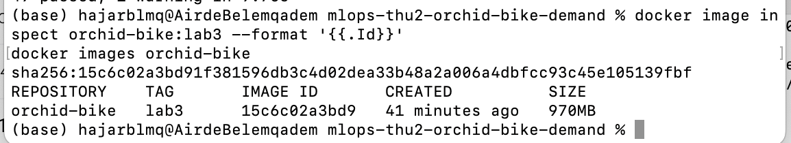
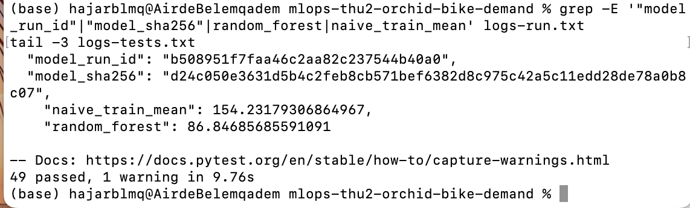
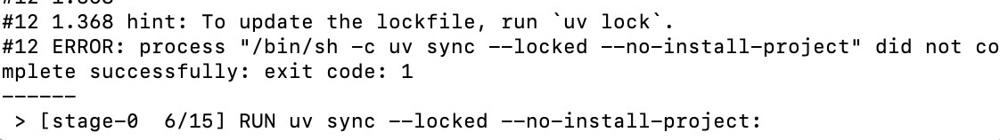

# Project scope

**User and goal**
The user is a bike-sharing operator who needs to anticipate demand.
Goal: estimate the total number of bike rentals for a given hour,
and expose this estimate through a prediction API.

**Input**
Calendar and weather information supplied for one hour:
hour, weekday, season, and weather conditions.

**Output**
- `prediction`: estimated hourly rentals
- `model_version`: identity of the loaded model

**In scope**
A prediction service (model + API + Docker), with tests, CI,
and evidence that it works and can be recovered.

**Non-goals**
- No real-time data collection, no user interface, no dashboard.
- Lab 1 does not train a model: it only sets up the team workflow
  and repairs the `normalize_team_slug` helper.

**How success is checked**
- Lab 1: `ruff`, `pytest -m infra` and `pytest -m lab1` pass on the merged commit.
- Later: the API returns a valid prediction and the model version,
  and the model beats the baseline.
## Lab 3: Docker rerun (same code, clean environment)

Team `mlops-thu2-orchid-bike-demand`. Branch `lab3-docker`, created from `main` at commit `37d5781` (merge of PR #2, Lab 2).

### Rebuild and rerun (run from the repository root)

Prerequisite: Docker Desktop is running.

    docker build -t orchid-bike:lab3 .
    docker run --name c1 orchid-bike:lab3
    docker run --rm orchid-bike:lab3 uv run --locked pytest -q
    docker cp c1:/app/reports ./out-reports
    docker rm c1

Expected result:
- 49 tests pass.
- Validation MAE: random forest 86.8469, comparator (training mean) 154.2318, the same as in Lab 2.
- Model readback: `reload_mae_delta` is 0.0.

To compare with Lab 2, open `out-reports/metrics.json` and compare it with `bike-demand/reports/metrics.json`. The `model_run_id` values differ (new run); this is expected.

### Evidence

| Item | Value |
| --- | --- |
| Base commit | `37d5781` |
| Image | `orchid-bike:lab3`, ID `sha256:15c6c02a3bd91f381596db3c4d02dea33b48a2a006a4dbfcc93c45e105139fbf` (970 MB) |
| Run in the container | `model_run_id` `b508951f7faa46c2aa82c237544b40a0` |
| Tests in the container | 49 passed |
| Raw logs | `reports/lab3/logs-build.txt`, `logs-run.txt`, `logs-tests.txt` |

The image was built from the working tree at base commit `37d5781`, plus the `Dockerfile` and `.dockerignore`, which were committed afterwards in `cd25a99`; `git diff 37d5781 cd25a99 -- bike-demand` is empty (the project code is identical).

Build and image ID:



Run and tests:



A stale lock makes `docker build` fail at the `uv sync --locked --no-install-project` step (tested on a throwaway copy, by adding `requests>=2` to `pyproject.toml` without updating `uv.lock`; raw log: `reports/lab3/logs-stale-lock-build.txt`):



### Dockerfile choices

- **`python:3.12-slim`**: matches `requires-python = ">=3.12,<3.13"`.
- **uv 0.12.24** copied from the official image, compatible with `required-version = ">=0.12.19,<0.13"`.
- **`pyproject.toml` and `uv.lock` first**, then `uv sync --locked --no-install-project`: the dependencies stay cached when only the code changes. A second `uv sync --locked` installs the project itself.
- **Copied into the image**: `src/`, `configs/`, `data/` (Lab 2 snapshot), `tests/`, `README.md`, `.python-version`, `.github/` and `reports/week-01-team.md` (the `preflight` test checks that they exist).
- **Not copied** (see `.dockerignore`): `.venv`, `.git`, caches, `.env`, `artifacts/`, `tracking/`, and the Lab 2 `reports/metrics.json`, so that the rerun starts from scratch.
- **`git` installed** with `apt-get`: `tracking.py` calls `git rev-parse HEAD` and `git status`.
- **`CMD`** in exec form: `uv run --locked python -m bike_demand.train --config configs/baseline.yaml` (Lab 3 only; since Lab 4, training runs in the `trainer` build stage and the `CMD` starts the API).

### Failures met during the build

| Step | Result | Cause | Fix |
| --- | --- | --- | --- |
| First tests in the container | 45 passed, 4 failed | `preflight` could not find `README.md`, `.python-version`, `reports/week-01-team.md`, `.github/workflows/ci.yml` | files copied into the image |
| Second try | 48 passed, 1 failed | `FileNotFoundError: 'git'` (readback test) | `git` installed in the image |
| Third try | 49 passed | | |

No test was disabled or changed.

### Notes

- The container is stable: two containers started from the same image give the same `model_sha256` (`d24c050e…`) and the same MAE.
- This `model_sha256` differs from the Lab 2 one (`fd98ceaf…`, Jade's run on Windows 11). The MAE values are identical, and Python (3.12.15) and the lock are the same. The cause is not established.
- `.git` is excluded from the image: the commit is recorded outside the container with `git rev-parse HEAD`.
- These checks are local (Docker Desktop on Mac), not a remote CI.


## Lab 4: Prediction API
 
The service loads the saved baseline model at startup and answers predictions. It never trains: training happens when the image is built (`trainer` stage of the `Dockerfile`).
 
### Build, test, run (Docker)
 
```
docker build -t orchid-bike:lab4 .
docker run --rm orchid-bike:lab4 uv run --locked pytest -q
docker run --rm -p 127.0.0.1:8000:8000 orchid-bike:lab4
```
 
### Endpoints
 
- `GET /health`: `200 {"status": "ok", "model_version": "..."}` when a model is loaded, `503` otherwise.
- `POST /predict`: flat JSON object with the 12 predictors (`season` 1-4, `yr` 0-1, `mnth` 1-12, `hr` 0-23, `holiday` 0-1, `weekday` 0-6, `workingday` 0-1, `weathersit` 1-4 as JSON integers; `temp`, `atemp`, `hum`, `windspeed` as numbers in 0-1). Returns `200 {"prediction": <finite number >= 0>, "model_version": "..."}`.

| Case | Status |
| Valid request, model loaded | 200 |
| Invalid request (missing/extra field, wrong type, out of range, NaN/Infinity, malformed JSON) | 422, even if no model is loaded |
| Valid request, model missing or unusable | 503 |
| Model fails or returns a non-finite/negative value | 500 |
 
**Extra fields are rejected (422).** In particular `cnt`, `casual` and `registered` are labels, not inputs. Numbers must be real JSON numbers: `"2"`, `2.0` for an integer field, and `true` are rejected. The 422 body lists only `loc`, `msg` and `type`, never the submitted value.
 
### Configuration
 
- `MODEL_PATH` (default `artifacts/model.joblib`)
- `METADATA_PATH` (default `model-metadata.json` next to the model)

`model_version` comes from the metadata file. Only load model files you trust (joblib uses pickle).
 
### Limits
 
The model is a baseline random forest; the API checks input ranges but cannot tell whether a prediction is good. A missing model keeps the service up and answering 503; there is no reload without restart.

## Lab 5: Deploy, log and check the service

This section is one path to follow from top to bottom. It starts the Lab 4 service from its Docker image with settings passed at start-up, sends real requests to it, reads one log line per request, and checks from outside the container which model is answering.

Run every command from the repository root. Each step says which commands to use:

- **Windows (PowerShell):** commands for Windows PowerShell. Use `curl.exe`, not `curl` (in PowerShell, `curl` is `Invoke-WebRequest` and asks for a `Uri`), and `python`, not `python3` (on Windows, `python3` may open the Microsoft Store).
- **macOS / Linux (Terminal):** commands for zsh or bash. Use `curl` and `python3`.
- **Windows and macOS / Linux:** the same command works in both.

### What "deployed" means, and who checks it

**Promise: what does "deployed" promise to others?**
Choice: the container was started from these README steps; `/health` returns 200; a valid `/predict` returns 200 with a finite, non-negative prediction; an invalid input gets 422; `model_version` equals the value recorded from the image at build time; and the check script (step 7) exits 0. It does not promise model quality, code identity, CI results or load behaviour. *Rejected:* "the container is running", which does not show which model answers.

**Final check** Run by `Jachriso` on `main` after the last Lab 5 merge and before the `m3` tag, by following steps 1 to 8 below. The output is saved in `reports/lab5/lab5-final-check.txt`. Until that file exists, the service is not called "deployed". 

### Before you start

- Docker Desktop is running.
- Python 3 is installed (the check uses the standard library only).
- The working tree is clean (`git status --short` prints nothing), so the revision written in the logs is the code that was built.
- Port 8000 is free. Remove containers left from an earlier run with `docker rm -f bike bike-broken` ("No such container" is fine).

### 1. Build the image

**Windows (PowerShell):**

```powershell
$rev = git rev-parse --short HEAD
docker build --build-arg SERVICE_REVISION=$rev -t orchid-bike:lab5 .
docker image inspect --format '{{.Id}}' orchid-bike:lab5
```

**macOS / Linux (Terminal):**

```bash
rev=$(git rev-parse --short HEAD)
docker build --build-arg SERVICE_REVISION=$rev -t orchid-bike:lab5 .
docker image inspect --format '{{.Id}}' orchid-bike:lab5
```

Note the commit (`echo $rev`) and the image ID: they are the first two links of the evidence chain (commit → image → run). The model is trained during this build (`trainer` stage of the `Dockerfile`); the service never trains. Without `--build-arg`, the logs say `"service_revision":"unknown"`.

### 2. Record the expected model

**Windows (PowerShell):**

```powershell
docker run --rm orchid-bike:lab5 cat artifacts/model-metadata.json
$expected = (docker run --rm orchid-bike:lab5 cat artifacts/model-metadata.json | Out-String | ConvertFrom-Json).model_version
echo $expected
```

**macOS / Linux (Terminal):**

```bash
docker run --rm orchid-bike:lab5 cat artifacts/model-metadata.json
expected=$(docker run --rm orchid-bike:lab5 cat artifacts/model-metadata.json | python3 -c "import sys, json; print(json.load(sys.stdin)['model_version'])")
echo $expected
```

The first command shows the whole metadata (keep `model_version` and `model_sha256` for your evidence); the second stores `model_version` in `$expected` (for example `baseline-b71392fa90e5`), used in steps 7 and 8. Keep the same terminal open until step 8. The value is read from the image, before the service runs, so the check cannot validate itself (see *expected*). It changes each time the model is retrained, so read it again after every build (see *identity*).

### 3. Start the service

**Windows and macOS / Linux:**

```
docker run -d --name bike -p 127.0.0.1:8000:8000 -e MODEL_PATH=artifacts/model.joblib orchid-bike:lab5
docker ps --filter name=bike
```

`docker ps` must show `bike` as `Up` with `127.0.0.1:8000->8000/tcp`. A container in `Created` did not start (usually port 8000 is still used by another container). `-p 127.0.0.1:8000:8000` publishes the port to your own machine only. The available settings are in [Settings](#settings).

### 4. Wait until it is ready

**Windows (PowerShell):**

```powershell
curl.exe -i http://127.0.0.1:8000/health
```

**macOS / Linux (Terminal):**

```bash
curl -i http://127.0.0.1:8000/health
```

The service is ready when this answers `200 {"status":"ok","model_version":"…"}` with the version from step 2. If the connection is refused, wait a few seconds and retry.

### 5. Send a valid and an invalid request

The bodies are written to files first, which avoids quoting problems. The 12 fields are described in "Lab 4: Endpoints".

**Windows (PowerShell):**

```powershell
'{"season":3,"yr":1,"mnth":7,"hr":17,"holiday":0,"weekday":3,"workingday":1,"weathersit":1,"temp":0.7,"atemp":0.65,"hum":0.5,"windspeed":0.2}' | Out-File -Encoding ascii ok.json
'{"season":3,"yr":1,"mnth":7,"hr":17,"holiday":0,"weekday":3,"workingday":1,"weathersit":1,"temp":0.7,"atemp":0.65,"hum":1.5,"windspeed":0.2}' | Out-File -Encoding ascii bad.json
curl.exe -s -w " [%{http_code}]`n" -X POST http://127.0.0.1:8000/predict -H "Content-Type: application/json" --data "@ok.json"
curl.exe -s -w " [%{http_code}]`n" -X POST http://127.0.0.1:8000/predict -H "Content-Type: application/json" --data "@bad.json"
```

**macOS / Linux (Terminal):**

```bash
echo '{"season":3,"yr":1,"mnth":7,"hr":17,"holiday":0,"weekday":3,"workingday":1,"weathersit":1,"temp":0.7,"atemp":0.65,"hum":0.5,"windspeed":0.2}' > ok.json
echo '{"season":3,"yr":1,"mnth":7,"hr":17,"holiday":0,"weekday":3,"workingday":1,"weathersit":1,"temp":0.7,"atemp":0.65,"hum":1.5,"windspeed":0.2}' > bad.json
curl -s -w ' [%{http_code}]\n' -X POST http://127.0.0.1:8000/predict -H "Content-Type: application/json" --data "@ok.json"
curl -s -w ' [%{http_code}]\n' -X POST http://127.0.0.1:8000/predict -H "Content-Type: application/json" --data "@bad.json"
```

Expected: `{"prediction":<number >= 0>,"model_version":"…"} [200]`, then `{"detail":[{"loc":["body","hum"],…}]} [422]`. `ok.json` and `bad.json` are scratch files: do not commit them.

### 6. Read the logs

**Windows and macOS / Linux:**

```
docker logs bike
```

After the start-up lines, each request writes exactly one JSON line (steps 4 and 5 give three lines). The `uvicorn` access log is off (`--no-access-log` in the `Dockerfile`), so a request never appears twice. Example lines (Annabelle's run, commit `6b85a88`):

```
{"timestamp":"2026-10-25T13:26:40.416+00:00","event":"request","request_id":"ca7faa38cbb1","method":"POST","path":"/predict","status":200,"outcome":"ok","duration_ms":78.3,"model_version":"baseline-657f25b9a370","service_revision":"6b85a88"}
{"timestamp":"2026-10-25T13:26:54.999+00:00","event":"request","request_id":"1c6bb5cafae3","method":"POST","path":"/predict","status":422,"outcome":"rejected","duration_ms":0.7,"model_version":"baseline-657f25b9a370","service_revision":"6b85a88","error_fields":["body.hum"]}
```

Each response carries the same id in its `X-Request-ID` header, so a client can quote it to the operator.

To keep the logs as a raw file:

- **Windows (PowerShell):** `cmd /c "docker logs bike > reports\lab5\<name>.log 2>&1"`. Do not use `docker logs bike *> file`: Windows PowerShell 5.1 wraps the start-up lines as `NativeCommandError` and mixes their order.
- **macOS / Linux (Terminal):** `docker logs bike > reports/lab5/<name>.log 2>&1`

### 7. Run the check

**Windows (PowerShell):**

```powershell
python scripts/check_deployed.py $expected
echo $LASTEXITCODE
```

**macOS / Linux (Terminal):**

```bash
python3 scripts/check_deployed.py $expected
echo $?
```

The script sends real HTTP requests to `http://127.0.0.1:8000` (no `TestClient`): `GET /health`, a valid `POST /predict` and an invalid one (`hum = 1.5`). It prints one row per claim and exits 0 only if every claim matches:

```
claim                       expected                  observed                    result
health status               200                       200                         ok
health model_version        baseline-32b2127e4f74     baseline-32b2127e4f74       ok
predict valid               200 + prediction >= 0     200 149.2911970908957       ok
predict model_version       baseline-32b2127e4f74     baseline-32b2127e4f74       ok
predict invalid (hum=1.5)   422                       422                         ok
exit status 0
```

To see it fail, pass a wrong value (`python scripts/check_deployed.py wrong-version` on Windows, `python3 …` on macOS / Linux): the two `model_version` rows become `FAIL` and the exit status is 1.

### 8. Break it on purpose

Start the service with a model path that does not exist, then repeat steps 4, 5 and 7 against it:

**Windows (PowerShell):**

```powershell
docker rm -f bike
docker run -d --name bike-broken -p 127.0.0.1:8000:8000 -e MODEL_PATH=/nonexistent/model.joblib orchid-bike:lab5
curl.exe -i http://127.0.0.1:8000/health
curl.exe -s -w " [%{http_code}]`n" -X POST http://127.0.0.1:8000/predict -H "Content-Type: application/json" --data "@ok.json"
curl.exe -s -w " [%{http_code}]`n" -X POST http://127.0.0.1:8000/predict -H "Content-Type: application/json" --data "@bad.json"
python scripts/check_deployed.py $expected
docker logs bike-broken
```

Use PowerShell, not Git Bash: Git Bash rewrites `/nonexistent/model.joblib` to `C:/Program Files/Git/nonexistent/model.joblib` (or prefix the command with `MSYS_NO_PATHCONV=1`).

**macOS / Linux (Terminal):**

```bash
docker rm -f bike
docker run -d --name bike-broken -p 127.0.0.1:8000:8000 -e MODEL_PATH=/nonexistent/model.joblib orchid-bike:lab5
curl -i http://127.0.0.1:8000/health
curl -s -w ' [%{http_code}]\n' -X POST http://127.0.0.1:8000/predict -H "Content-Type: application/json" --data "@ok.json"
curl -s -w ' [%{http_code}]\n' -X POST http://127.0.0.1:8000/predict -H "Content-Type: application/json" --data "@bad.json"
python3 scripts/check_deployed.py $expected
docker logs bike-broken
```

| Request | Observed |
| --- | --- |
| `GET /health` | 503 `{"detail":"no usable model loaded"}` |
| `POST /predict`, valid body | 503 |
| `POST /predict`, `hum = 1.5` | 422 (validation runs before the model check) |
| check script | 4 rows `FAIL`, `predict invalid` ok, exit status 1 |

**Failure: what does it leave behind?** In `docker logs bike-broken`, one `ERROR` line at start-up names the missing file, and every 503 request line says why:

```
ERROR:    no usable model, /health and /predict answer 503: model file not found: /nonexistent/model.joblib
INFO:     Application startup complete.
{"timestamp":"2026-10-25T13:41:30.003+00:00","event":"request","request_id":"dbf8b5e13088","method":"POST","path":"/predict","status":503,"outcome":"unavailable","duration_ms":2.0,"model_version":null,"service_revision":"6b85a88","reason":"no_model"}
```

Someone who reads only the logs can find the cause. `Application startup complete` is printed even though the service is not ready, so readiness must be read from `/health`, not from that line.

### 9. Stop

**Windows and macOS / Linux:**

```
docker rm -f bike bike-broken
```

Then delete the scratch files `ok.json` and `bad.json`.

### Settings

| Variable | Default | If wrong |
| --- | --- | --- |
| `MODEL_PATH` | `artifacts/model.joblib` (inside the image) | the service stays up, `/health` and `/predict` answer 503, one `ERROR` line at start-up names the cause |
| `METADATA_PATH` | `model-metadata.json` next to the model | same as above (`metadata file not found: …`) |
| `SERVICE_REVISION` | set at build time by `--build-arg`, otherwise `unknown` | the logs say `"service_revision":"unknown"` |

### Decisions

Each answer gives our choice, the option we rejected, and why. *Promise* is at the top of this section and *failure* in step 8.

#### Start-up (Léona, PR #8)

**Settings: what changes between laptop and container?**
Only the model location is configurable, through environment variables passed with `-e` at `docker run`. The image is the same everywhere. *Rejected:* hard-coding paths in the code or baking a per-machine config file into the image, because the same image could then not run elsewhere without a rebuild.

**Model: where does it come from at start-up?**
The model is trained once at build time (`trainer` stage) and copied into the final image under `artifacts/`. The service only loads it, once, when it starts; it never trains. `MODEL_PATH` can point to another trusted file. *Rejected:* training at start-up (slow, and each start could produce a different model) and downloading the model at start-up (needs network and credentials).

**Ready: when do we call the service ready?**
When `GET /health` answers `200` with a `model_version`, which only happens after the model and its metadata were loaded and checked. *Rejected:* "the container is running" or the log line `Application startup complete`: both appear even when no model is loaded.

**Broken: what does it say if the model is missing?**
It stays up and fails closed: `/health` and a valid `/predict` answer `503 {"detail":"no usable model loaded"}`, while an invalid request still gets `422`. The start-up log names the cause in one line, and each request line says `"reason":"no_model"`. *Rejected:* crashing at start-up (the operator gets no `/health` answer to read) and answering with a default prediction (a confident wrong answer).

#### Logging (Annabelle, PR #10)

**Log line: what must one request tell an operator?**
Choice: `timestamp`, `request_id` (also returned in the `X-Request-ID` header), `method`, `path`, `status`, `outcome` (`ok`, `rejected`, `unavailable`, `error`, `refused`), `duration_ms`, `model_version` (null when no model is loaded) and `service_revision`. Two optional fields explain failures: `reason` (`no_model`, `prediction_failed`, `invalid_prediction`) and `error_fields` (for a 422, the names of the wrong fields, for example `body.hum`). An operator reading only these lines can tell which request it was, what happened, how long it took, and which model and code answered. *Rejected:* the default `uvicorn` access line (status only, no model, code, reason or request id, and it would duplicate ours); free-text messages (hard to search); logging the request body or the prediction to make debugging easier (see *secrets*).

**Secrets: what must never appear in a log?**
Choice: request bodies, query strings, headers (for example `Authorization`), environment variables, prediction values, text chosen by the client (any path other than `/health` and `/predict` is logged as `(other)`), and any metric computed on the test period. The service has no secret today, so the rule is "log metadata, not payloads". For a 422, the line lists the wrong field names, never the values sent. Tests in `bike-demand/tests/test_request_logging.py` check that a body value, a query-string value, a header value and an unknown path do not appear in the line. *Rejected:* logging the whole request for easier debugging, because a payload can carry private or sensitive data, and the same rule already keeps values out of the 422 response.

#### Identity and expected model (Hajar, PR #9)

**Identity: which id shows which model is running?**
Choice: `model_version`, returned by `/health`, `/predict` and every log line. It comes from `artifacts/model-metadata.json`, which also stores `model_sha256`. Hajar checked that `sha256sum artifacts/model.joblib` in the container gives the same value as `model_sha256` in the metadata (`d24c050e…`). The check compares `model_version` only, because `/health` does not return `model_sha256`. *Rejected:* the image tag (it can be moved and says nothing about the model inside) and the image ID (it identifies one build, not the model).

Note: `model_version` is not reproducible. `train.py` builds it with `uuid4()`, a random value drawn at each training, so each build that retrains gives a new string (we saw five different strings, with the same training code and data), while `model_sha256` stayed `d24c050e…` in the builds where we read it. The string identifies one build, which is why the expected value is read from the image after each build.

**Expected: who knows the expected model, and when?**
Choice: whoever builds the image reads the metadata from the image right after the build (step 2) and passes `model_version` to the script as an argument. *Rejected:* reading the expected value from the running service (the check would validate itself), and hard-coding it in the repository (it would fail after the next build, see the note above).

### Evidence

Each run was made by its author on their own machine; image IDs differ because each person built their own image.

| Run | Commit | Image | Result | Raw evidence |
| --- | --- | --- | --- | --- |
| Start-up (Léona, Windows 11) | `cab9507` | `sha256:76a4c875…` | health 200, predict 200, `hum = 1.5` 422; missing model 503 / 503 / 422 | PR #8 description |
| Check (Hajar, macOS) | `cab9507` | `sha256:53a5ab37…` (`bike-demand:dev`, container `c1`) | exit 0 with the right version, exit 1 with a wrong one | `reports/lab5/lab5-check-ok.txt`, `reports/lab5/lab5-check-fail.txt`, `reports/lab5/lab5-logs-raw.txt` |
| Logging (Annabelle) | `6b85a88` | `8c5567d14241` | 145 tests passed in the image; one line per request; check exit 0; missing model logged with `reason` | `reports/lab5/lab5-logging-*.txt` |
| Final check (Jade, Windows 11) | `d41f51c` (`main`) | `sha256:c2907919…` | steps 1 to 9: 5 claims ok, exit 0; broken model 503 / 503 / 422, exit 1 | `reports/lab5/lab5-final-check.txt` (commit `806c39c`) |

### Limits

- The check compares `model_version` only. It does not compare `model_sha256` or `service_revision`, so code identity is visible in the logs but not verified. The model metadata has `training_commit: "unavailable"`.
- The expected value comes from the same image, so the check detects a wrong or stale container, not a bad build.
- `service_revision` is only as good as the value passed at build time: a dirty tree or a forgotten `--build-arg` gives a wrong or `"unknown"` value.
- If the model raises an unexpected error, the traceback is still written to the container log by the `uvicorn.error` logger, with the exception text. We did not review what such a text could contain.
- `uv run` re-installs the project at each container start (`Uninstalled 1 package / Installed 1 package` in the logs). Cause found in Week 3: uv compares the ctime of `pyproject.toml` and `src/` with the one it recorded at build time, and Docker resets the ctime when it writes the image layers (raw output in `reports/lab3/uv-reinstall-diagnosis.txt`, explanation in `reports/week-2.md`).
- No log retention or access control is defined; these are local logs. All Lab 5 runs are local; CI and the Cloud Run deploy come in Lab 6 (next section).

## Lab 6: CI and deploy to Cloud Run

Two workflows in `.github/workflows/`. Every action is pinned to a commit SHA, permissions are read-only by default, every job has a time limit, and every install comes from `uv.lock` (`uv sync --locked`). No secret or key is stored in the repository.

### What runs, and when

| Workflow | Trigger | Job / step | What it checks | Fails when |
| --- | --- | --- | --- | --- |
| `ci.yml` | pull request to `main`, push to `main`, manual | `lint` | `uv sync --locked`, `preflight`, `ruff check`, `ruff format --check` | the lock is stale, a required file is missing, a lint or format error |
| | | `tests` (after `lint`): fast tests | `pytest -m "not regression"` (145 tests: data, split, baseline, API, logging, infra, lab1) | any behaviour test fails |
| | | `tests`: regression | `pytest -m regression` (2 tests): retrains from the data snapshot and compares the validation MAEs with `bike-demand/reports/metrics.json` | the recomputed MAE differs from the recorded one by more than `1e-6` |
| | | `tests`: upload test logs | both pytest logs kept as artifact `pytest-logs-<sha>` (14 days), even when red | — |
| `deploy.yml` | the `CI` workflow completed on `main` | `deploy`, only if that CI run was a **push to `main`** and **succeeded** | build the image tagged with the commit, push it to Artifact Registry, deploy a new revision with no traffic, switch the traffic, run the Lab 5 check on the live URL | any step fails; if the live check fails, traffic goes back to the previous revision |

A new push to a pull request cancels the outdated CI run on that pull request; runs on `main` are never cancelled. Deploys never run in parallel and are never cancelled halfway.

### Reproduce a failure locally

Run from `bike-demand/` (same commands on Windows PowerShell and macOS / Linux). The CI runs exactly these commands.

```
uv sync --locked
uv run --locked ruff check .
uv run --locked ruff format --check .
uv run --locked pytest -q -m "not regression"
uv run --locked pytest -q -m regression
```

- **Format (seen in CI run #1, `reports/lab6/lab6-ci-ddfd529-red.txt`):** the Lab 5 files `api.py`, `test_api.py` and `test_request_logging.py` were not formatted, and `ruff format --check .` printed `3 files would be reformatted` with exit code 1. `uv run --locked ruff format .` fixes it.
- **Regression (`reports/lab6/lab6-tests-regression-red.txt`):** in `src/bike_demand/train.py`, train on `registered` instead of `cnt`, then run the regression tests: `113.93061096197528 == 86.84685685591091 ± 1.0e-06` fails. Revert the change afterwards.

### Test map

| Test | Defect it catches | Shown red |
| --- | --- | --- |
| `ruff format --check` (CI step) | code that does not follow the team format | CI run #1, PR #12, commit `ddfd529` (`reports/lab6/lab6-ci-ddfd529-red.txt`) |
| `test_random_forest_validation_mae_matches_recorded` | drift in the training code: wrong target, features, split window or model settings change the validation MAE | target set to `registered`: 113.93 vs 86.85 (`reports/lab6/lab6-tests-regression-red.txt`, run on Hajar's Mac) |
| `test_naive_mean_validation_mae_matches_recorded` | drift in the comparator: wrong training statistic or split | `mean` replaced by `median`: 159.95 vs 154.23 (same file) |
| `scripts/check_deployed.py` on the live URL (deploy step) | the live service answers with another model, does not answer, or accepts invalid input | Lab 5: a wrong expected version gives 2 `FAIL`, exit 1 (`reports/lab5/lab5-check-fail.txt`); not yet seen red on Cloud Run |

### Decisions

Each answer gives our choice, the option we rejected, and why.

#### What the pipeline checks

**Coverage: what do our checks not cover yet?**
Choice: we list the gaps instead of hiding them. CI does not build the Docker image (only the deploy does, after the merge), does not start the API in a container, does not run on Windows or macOS (where the team works), and does not test the README commands or `check_deployed.py` itself. Model quality is only checked as "the same MAE as recorded", not "better than the comparator". *Rejected:* adding a Docker build to every pull request now: about 2 minutes per run (see the deploy log) for a risk the deploy already catches before any traffic moves.

**Machine: what does a clean runner not have?**
Choice: the runner starts from `ubuntu-24.04` with nothing of ours: no `.venv`, no uv cache, no trained model (`artifacts/` is not in git), no MLflow `tracking/` folder, no Google Cloud credentials, and only the checked-out commit. So every run installs from `uv.lock`, and the regression test retrains from the data snapshot instead of loading a model file. *Rejected:* committing a model or caching `.venv` between runs: CI would then test what is on someone's disk, not what the commit produces.

**Trigger: which changes should start which checks?**
Choice: every pull request to `main` and every push to `main` run all of `ci.yml`, with no path filter. A deploy starts only from a green CI run on a push to `main`. *Rejected:* path filters (for example "skip CI when only Markdown changes"): `preflight` checks that `README.md` and other files exist, so a documentation change can break CI too.

**Order: which check should fail first, and why?**
Choice: `lint` first (lock, preflight, ruff), then the fast tests, then the regression tests that retrain the model. The cheapest check that catches the most common mistake fails first: run #1 stopped at `ruff format` after 19 seconds, without spending time on the tests. Fast tests and regression tests are separate steps, so the log says which kind of defect it is. *Rejected:* one job with a single `pytest` run: a format error would cost the full test time, and a red run would not say whether a behaviour or a recorded number changed.

**Evidence: what can CI claim about the model?**
- CI can claim: this commit, installed from `uv.lock` on `ubuntu-24.04`, passed lint, 145 fast tests and 2 regression tests, and the runner itself retrained the baseline and got the validation MAEs recorded in `reports/metrics.json` (86.8469 and 154.2318) within `1e-6`.
- CI cannot claim anything about our laptops' MLflow runs, local model files, or the model in the deployed image (the deploy retrains in its own Docker build and gets a new `model_version`).
- CI computes no test-period metric and says nothing about the model's quality on future data.

#### Whether the tests work

**Defects: which bug does each test catch?**
See the test map above: each line names one defect. *Rejected:* a placeholder test (`assert True`, in the first version of PR #13): it can never fail, so it catches nothing.

**Failing: can we make each test fail?**
Yes: each line of the test map was made red on purpose, then reverted (raw outputs in `reports/lab6/`), except the live check, which has only been seen red locally (Lab 5). The first version of the regression test trained its own copy of the model instead of calling `fit_evaluate`; during the review of PR #13, a wrong target in `train.py` did not turn it red. The merged version calls the project code (`fit_evaluate`, `compare_mean`, `split_data`) and fails on that defect (113.93 vs 86.85). *Rejected:* trusting a test that was only ever seen green.

**Tolerance: where does our number come from?**
Choice: `1e-6`, from measured variation. The seed is fixed (`random_state=42`, `n_jobs=1`), `metrics.json` records `reload_mae_delta = 0.0`, three local recomputations gave a delta of exactly 0.0, and the CI run on `ubuntu-24.04` gave the same values. The tolerance only absorbs float rounding across platforms. *Rejected:* a loose tolerance such as 0.5, which would hide a real regression.

**Repair: did we fix the cause or hide it?**
Choice: fix the cause. CI run #1 (format): we ran `ruff format` on the three files (`d720474`); we did not remove the format check or exclude the files. Deploy run #1 (permission, see "Red to green" below): we granted the missing read permission to the deploy account; we did not remove the traffic switch or mark the step `continue-on-error`. If a regression test turns red, the fix is the training code, or a retrain with a new `metrics.json` in a reviewed pull request; never a wider tolerance.

**Records: what is still readable in 3 months?**
Choice: everything we cite is in the repository as text: raw logs of each red and green run in `reports/lab6/`, the recorded metrics in `bike-demand/reports/metrics.json`, the workflows with pinned versions, and this README. *Rejected:* links to Actions runs and artifacts only: the test-log artifacts expire after 14 days and the deploy records after 30 days.

#### Delivering to Cloud Run

**Gate: which branch and checks gate a deploy?**
Choice: only `main`, only after the `CI` workflow succeeded on a push to `main` (`workflow_run` plus an `if` on the conclusion, the event and the branch). The deploy checks out the exact commit CI tested (`head_sha`), not whatever `main` is when the deploy starts. A pull request, a red CI or another branch deploys nothing. *Rejected:* a deploy job inside `ci.yml`: it would put the `id-token: write` permission next to the pull-request jobs. Limit: `main` has no branch protection rule, so "only reviewed pull requests reach `main`" is a team rule, not enforced by GitHub.

**Identity: how does it log in with no stored key?**
Choice: Workload Identity Federation. The job asks GitHub for a short-lived OIDC token (`id-token: write`), and `google-github-actions/auth` exchanges it for the service account `github-deployer@mlops-demo-512323.iam.gserviceaccount.com`. The provider, the account and the Artifact Registry repository are repository variables (not secrets: none of them gives access on its own). The same login gives the identity token for the private service. *Rejected:* a service-account JSON key stored as a GitHub secret: a long-lived key that works from anywhere if it leaks.

**Proof: what shows the new revision is live?**
Choice: after the traffic switch, the deploy runs `scripts/check_deployed.py` (the Lab 5 check) on the live URL with an identity token. The expected `model_version` is read from the image built in the same run, before the service answers. The output is saved with the commit, the image, the checked revision, the previous revision and the traffic table, and uploaded as `deploy-record-<sha>` (copy in `reports/lab6/lab6-deploy-live-check.txt`). *Rejected:* "the deploy command printed Done": that shows a revision exists, not which model answers.

**Undo: what do we do if the live check fails?**
Choice: the new revision is deployed with `--no-traffic`, and the revision serving before is recorded first. If the live check fails, the `Roll back` step sends 100% of the traffic back to that previous revision. **The previous revision stays served until the traffic is switched:** in deploy run #1 the traffic switch failed, and `mlops-thu2-orchid-bike-demand-demo-00005-j4x` kept 100% of the traffic while the new revision `00007-m94` got 0%. *Rejected:* `gcloud run deploy` with immediate traffic, which serves the new revision before it is checked. Limit: the rollback step has not been exercised yet (no live check has failed).

### Red to green

| Run | Commit | Result | Cause (from the log) | Repair | Raw log |
| --- | --- | --- | --- | --- | --- |
| CI #1, PR #12 | `ddfd529` | red, step `ruff format --check` | 3 Lab 5 files not formatted | `d720474` on the same PR: `ruff format` | `reports/lab6/lab6-ci-ddfd529-red.txt` |
| CI #2, PR #12 | `d720474` | green | | | Actions only |
| Deploy #1, attempt 1 | `4287323` (`main`) | red, step "Deploy a new revision" | `update-traffic` denied: `artifactregistry.repositories.downloadArtifacts` on repository `cloud-run-source-deploy` | `github-deployer` granted the Artifact Registry `reader` role on `cloud-run-source-deploy` | `reports/lab6/lab6-deploy-1-red.txt` |
| Deploy #1, attempt 2 | `4287323` (`main`) | green: revision `00008-z4d` at 100%, live check 5 ok, exit 0 | | | `reports/lab6/lab6-deploy-2-green.txt`, `reports/lab6/lab6-deploy-live-check.txt` |

**Deploy diagnosis.** The image was built and pushed, and the new revision was created. Moving the traffic failed because the deploy account must be able to read the image of every revision named in the traffic, including the one already serving. The previous revision `00005-j4x` had been deployed by hand from source, so its image is in the `cloud-run-source-deploy` repository, where the deploy account had no read access (it could only use our `orchid-bike` repository). The repair is a permission in Google Cloud, not a change in the repository, which is why attempt 2 ran on the same commit: the run was re-run after the cause was fixed, not "until it turned green".

### Deploy record (current live revision)

```
target https://mlops-thu2-orchid-bike-demand-demo-7md3wlybfq-ew.a.run.app
claim                       expected                  observed                    result
health status               200                       200                         ok
health model_version        baseline-cf856982003d     baseline-cf856982003d       ok
predict valid               200 + prediction >= 0     200 149.2911970908957       ok
predict model_version       baseline-cf856982003d     baseline-cf856982003d       ok
predict invalid (hum=1.5)   422                       422                         ok
exit status 0
commit           4287323da4162adfc1d8039b29e050ae9dbfc4ee
image            europe-west1-docker.pkg.dev/mlops-demo-512323/orchid-bike/orchid-bike:4287323da4162adfc1d8039b29e050ae9dbfc4ee
checked revision mlops-thu2-orchid-bike-demand-demo-00008-z4d
previous         mlops-thu2-orchid-bike-demand-demo-00005-j4x
REVISION_NAME                                     PERCENT
['mlops-thu2-orchid-bike-demand-demo-00008-z4d']  [100]
```

### Limits

- The deploy retrains during `docker build`, so each deploy gets a new `model_version` (same commit: attempt 1 built `baseline-e980b74b3569`, attempt 2 `baseline-cf856982003d`). Attempt 2 pushed the same tag `orchid-bike:<sha>` again, so that tag now points to the second image; the deploy record says which revision and model are live.
- The model deployed is not the one CI tested: CI checks that the training code reproduces the recorded MAE; the deploy checks the identity of the model in its own image.
- `main` is not protected by a branch rule; the review requirement is a team rule.
- The rollback step and a red live check on Cloud Run have not been seen yet.

## Lab 7: Pipeline and gate

Status: **increment 1 of 3 done** (accepted reference and recovery path). The policy, the pipeline command and the promotion come in the next pull requests; the table at the end says who owns what.

### What `main` did before Lab 7

| Question | Finding in the code | Consequence |
| --- | --- | --- |
| Training boundary | `python -m bike_demand.train --config configs/baseline.yaml` validates, fits, evaluates and writes its outputs in one call. | There is no step between "trained" and "served". |
| Overwrite risk | `train_baseline` writes `artifacts/model.joblib` and overwrites `reports/metrics.json` before anything is decided. The `Dockerfile` also retrains at every build, and the Lab 6 deploy serves that model. | Any run replaces the model; Cloud Run serves a model no gate accepted. |
| Settings guard | `load_config` rejects any `model` settings other than `DEFAULT_MODEL` (50 trees, depth 10). | No candidate can exist without a reviewed change to this guard. |
| Identity | `model_version` is `baseline-` + `uuid4()`, a new random string at every training. `model_sha256` is stable: `d24c050e…8c07` in every Linux build since Lab 3. | The identity of an accepted version is the digest of its bytes, not `model_version`. |

### Shared contract (proposed, to be confirmed by the team in the policy PR)

- **Inputs:** the frozen snapshot `data/raw/hour.csv` (checked against `data/manifest.json`), the twelve ordered predictors, `uv.lock`, the policy file and the candidate's model settings. Candidates change model settings only.
- **Evaluation rows:** train = 2011 (fit only), validation = Jan–Jun 2012 (4,358 rows, every comparison), test = Jul–Dec 2012 (never used, no metric).
- **Outcomes:** `accept` (every criterion passed), `reject` (a measured rule failed), `blocked` (a required check did not run or its evidence is invalid; never counted as a pass).
- **What a candidate may write:** only its own new run folder. Never `models/accepted.json`, never an accepted bundle, never `artifacts/` of the served image.
- **Accepted state:** a bundle in Google Cloud Storage + the committed pointer `bike-demand/models/accepted.json`. Only a reviewed pull request on `main` changes the pointer.

### Accepted state

A **bundle** is a folder with the exact bytes of one version: `model.joblib`, `model-metadata.json` (what the API serves), `uv.lock` (dependencies) and `manifest.json` (sha256 of each file, data digest, feature order, validation rows and MAEs, source commit). Bundles are stored outside Git, in the bucket `gs://mlops-demo-512323-orchid-bike-models/bundles/<version>-<first 12 hex of model_sha256>/`; `*.joblib` and `bundles/` are ignored by Git.

The **pointer** `bike-demand/models/accepted.json` is committed. `current` names the accepted bundle by the sha256 of its manifest (so it names exact bytes, since the manifest lists the digest of every file); `previous` keeps every version it replaced, newest first.

`python -m bike_demand.bundle verify <folder> --pointer models/accepted.json` (run from `bike-demand/`):
1. checks the manifest digest against the pointer, then every file digest against the manifest, then metadata against manifest, **before loading the model**;
2. recomputes the validation MAE of the model and of the train-mean comparator on the same 4,358 rows, and compares them with the manifest (tolerance `1e-6`, as in Lab 6);
3. prints a JSON result and exits 0, or prints the reason and exits 1.

Tests: `bike-demand/tests/test_bundle.py` (a changed model byte fails *without* the model being loaded, a missing file fails, a pointer naming another manifest fails, an MAE that cannot be reproduced fails, an existing bundle is never overwritten).

**v1, the accepted reference.**

| Item | Value |
| --- | --- |
| Version | `v1`: the Week 1 random forest preset (`n_estimators` 50, `max_depth` 10, `random_state` 42, `n_jobs` 1) |
| Bytes | trained by `docker build --target trainer` in a clean checkout of `main` at `4287323` (the trainer stage ran, not cached) |
| `model_sha256` | `d24c050e3631d5b4c2feb8cb571bef6382d8c975c42a5c11edd28de78a0b8c07` (the same digest as Lab 3, Lab 5 and the final check) |
| Manifest sha256 | `75dedf7d7a60236f08b030ef87bab08c5f293f5ed357c7518e9d40ef5d4ff775` |
| `model_version` served | `baseline-0b7ee4462ec6` |
| Validation MAE | model 86.84685685591091, train-mean comparator 154.23179306864967: identical to the values recorded in Lab 2 (`reports/metrics.json`) |
| Decision | bootstrap, not gated: v1 is the reference the gate compares candidates with; the gate does not exist yet |
| Stored | `gs://mlops-demo-512323-orchid-bike-models/bundles/v1-d24c050e3631/` (bucket in `europe-west1`, object versioning on, public access prevented); uploaded from Cloud Shell, downloaded back with the same four sha256 |
| Read access | project viewers, editors and owners (bucket defaults); `github-deployer` (`roles/storage.objectViewer`, for the deploy) |
| Raw evidence | `reports/lab7/lab7-accepted-v1-create.txt` (creation and verification), `reports/lab7/lab7-bucket-creation.txt` (bucket, upload, download check, read access) |

### Recover the accepted version without retraining

From `bike-demand/` (needs read access to the bucket):

```
gcloud storage cp -r gs://mlops-demo-512323-orchid-bike-models/bundles/v1-d24c050e3631 bundles/
uv run --locked python -m bike_demand.bundle verify bundles/v1-d24c050e3631 --pointer models/accepted.json
```

Exit 0 means: these are the accepted bytes, and they still give the recorded validation MAE. To recover an older version, use the `bundle_uri` and `manifest_sha256` of its entry in `previous`.

### Design answers

Answered in this increment:

**Reference: which accepted version is frozen?**
Choice: the version named by `current` in `models/accepted.json` at the commit the candidate is evaluated from; today `v1` (manifest `75dedf7d…`). *Rejected:* "the model in `artifacts/`" or "the model on Cloud Run": both change at every build (`train.py` overwrites `artifacts/`, the `Dockerfile` retrains), so the comparison would move under us.

**Observations: same rows and labels for both?**
Choice: yes, the validation partition of the frozen snapshot (4,358 rows, Jan–Jun 2012), checked by the snapshot digest before every evaluation; the bundle records the digest and the row count, and `verify` fails if either differs. *Rejected:* reusing a score computed on another split or snapshot.

**Provenance: what makes an old score reusable?**
Choice: a recorded score is reused only if the bytes, the data digest, the feature order and the row count all match, and `verify` reproduces it within `1e-6` on the current code and lock. *Rejected:* trusting a number in a report or an MLflow run from a laptop, which a clean checkout cannot check.

**Identity (accepted state): what stays immutable for its lifetime?**
Choice: the bundle folder and its four files; the pointer names it by manifest digest. A bundle is never edited (`create` refuses a non-empty folder); a new model is a new folder. *Rejected:* `model_version` alone (random, changes with every training) or an image tag (the Lab 6 deploy moved the same tag to a new image).

**Retain: what recovers without retraining?**
Choice: every accepted bundle stays in the bucket, and `previous` in the pointer keeps its URI and manifest digest, so any accepted version can be downloaded and verified with the two commands above. *Rejected:* keeping only the current model, or rebuilding an old version from its commit (retraining gives a new `model_version`, and depends on the platform: the Windows Lab 2 run gave another `model_sha256`).

To be answered by the owner of each part, in their pull request:

| Questions | Part | Owner |
| --- | --- | --- |
| metric, margin; Quality, Operation and Integrity rules; invalid, missing, reject, blocked, status | policy and gate checks (policy committed **before** any candidate is evaluated) | Annabelle (lead) |
| stage, entry point, failure, partial, identity (run); separate (candidate side) | pipeline command and candidate runs, including one genuine rejection | Hajar |
| switch, concurrent; serving the accepted bundle on Cloud Run; rejection leaves accepted state unchanged | promotion and deploy | Jade |
| independent challenge of one claim | review | Léona |

### Limits of increment 1

- Cloud Run still serves a model trained during the Lab 6 deploy build (`model_version` `baseline-cf856982003d`), not the v1 bundle: the `Dockerfile` still retrains. Serving the accepted bundle is part of the promotion work.
- `train.py` still overwrites `artifacts/` and `reports/metrics.json`; the pipeline command must not call it as it is.

### Policy and gate (Annabelle)
 
The gate policy is [`bike-demand/policy/gate-policy.yaml`](bike-demand/policy/gate-policy.yaml) (version 2). Version 1 was committed before any candidate was evaluated: the only numbers used to write it are the recorded v1 validation MAEs (model 86.8469, train-mean comparator 154.2318). Version 2 only adds `candidate_settings`: it was written after the candidate runs recorded in `reports/lab7/decisions/`, its upper bounds equal the largest settings already evaluated, and it changes no rule, margin or budget. Those decision records carry `policy_version` 1.
 
**Shared contract.** Confirmed as proposed, with these additions :
- a candidate writes `model.joblib` and a `model-metadata.json` with `model_version` and the twelve `features`, because the Operation check loads it with the API loader (`api.load_model`);
- the pipeline exits 0 / 1 / 2 for accept / reject / blocked;
- the settings a candidate may change, with their bounds, and the settings that stay fixed are declared in the policy (`candidate_settings`, version 2) and read by the pipeline;
- candidates are produced in the project's Linux container: the bytes of a model differ between platforms while its MAE does not (Windows run `fd98ceaf...`, Linux builds `d24c050e...`, same validation MAE 86.84685685591091).

**Metric : what does the score mean, in what unit?**
Choice: the MAE of `cnt` on the 4,358 validation rows (Jan-Jun 2012), in bikes per hour, lower is better. The train-mean comparator, the incumbent and the candidate are scored on the same rows and labels. The test period (Jul-Dec 2012) is never used.
*Rejected :* a score computed on another partition, or an MLflow run from a laptop. Why: MAE is the metric recorded since Lab 2 and has a direct unit.
 
**Margin : what size of change matters, and why?**
Choice : a candidate must improve on the incumbent by at least 2 % of its MAE: `candidate_mae <= 0.98 x incumbent_mae` (about 85.11 against v1). This is a judgment, not a measurement: I did not measure how the v1 MAE varies from month to month. Numerical noise is not the reason: with a fixed seed and `n_jobs=1` the recomputed MAE was identical across platforms in Lab 6 (see `bundle.py`) and `reports/metrics.json` records `reload_mae_delta = 0.0`. The margin protects against a gain that only reflects the single six-month validation window, and against changing the served model for a gain too small to matter. It is relative, so it follows the incumbent after a promotion.
*Rejected :* a zero margin (any gain, even noise-level, would qualify) and a non-regression rule (it would accept an equivalent model, which does not show improved accuracy). The margin was fixed before any candidate; changing it needs a reviewed revision with a reason.
 
**Quality : what must a candidate prove?**
Choice : two rules, both required: it beats the train-mean comparator, and it improves on the incumbent by the margin, on the same validation rows. If the incumbent evidence is unavailable, the quality check is not passed (blocked).
*Rejected :* comparing only with the train-mean baseline, which any reasonable model beats.
 
**Operation : what serving condition, and why?**
Choice : the candidate's model and metadata must be accepted by `api.load_model`, and its predictions on every validation row must be finite and non-negative. Why: the API refuses to start with another metadata contract and answers 500 for a non-finite or negative prediction.
*Rejected :* a latency bound: a small benchmark does not establish a service level, and the settings we vary are unlikely to change latency much (not measured here).
 
**Integrity : which inputs and which bytes?**
Choice : the snapshot passes `check_snapshot` (digest, size, header, rows against `data/manifest.json`); the features are the twelve ordered predictors; the validation rows number 4,358; the sha256 of the candidate's `model.joblib` equals its record, checked before the model is loaded; the incumbent passes `bundle verify` (exit 0); the candidate's `uv.lock` equals the incumbent's; only model settings change, with `random_state` 42 and `n_jobs` 1 fixed.
*Rejected :* trusting a score without checking its inputs and bytes.
 
**Invalid : what evidence must never count as a pass?**
Choice : a non-finite number (NaN, infinity), a boolean, a string where a number is expected, a negative MAE, or a row count that differs from 4,358. It makes the run `blocked`.
*Rejected :* letting such a value reach an inequality (`nan <= x` is false, `True` is a number in Python).
 
**Missing: what if a required check did not run?**
Choice : `blocked`, with the name of the missing check. A check that did not run is never a passed check, and a better MAE does not replace it.
*Rejected :* treating an absent check as a pass.
 
**Reject : which measured rule failed?**
Choice : `reject` when the evidence is valid and complete and at least one quality or operation rule failed, for example a MAE above the threshold. The record lists each rule with its value.
*Rejected :* a single pass / fail without reasons.
 
**Blocked : what must be repaired before deciding?**
Choice : `blocked` when an integrity rule fails or required evidence is missing or invalid (digest differs, snapshot differs, incumbent not verifiable, check could not run).
The cause is repaired, then the run is repeated. This is not a policy decision and not a new candidate.
*Rejected :* calling an incomplete evaluation a rejection.
 
**Status : how does CI observe the outcome?**
Choice : the exit status (0 accept, 1 reject, 2 blocked) and a decision record in `reports/lab7/decisions/`, written by the pipeline from the gate's decision: the run name, the training commit, the candidate config, the observed evidence (including the incumbent's MAE and lock digest), the policy version and the rule-by-rule reasons. It does not record the commit of the policy file.
The gate decides from what the pipeline observed, not from a "passed" flag written by the candidate.
*Rejected :* one non-zero code for everything that is not accept, because CI could not tell a measured rejection from an incomplete evaluation.
 
**Budget**
Choice : at most 4 distinct model settings evaluated on the validation rows. Blocked runs count; a rerun of the same settings after an infrastructure failure is recorded but does not count. A fifth candidate needs a reviewed revision of the policy. How the pipeline applies this rule is described in "Pipeline boundary": it counts by run identity (settings, data digest and commit).
Why : every extra candidate evaluated on the same rows makes the best score look better than it is.
*Rejected :* an unlimited grid of settings.
 
**Candidate settings: what may a candidate change, and within what bounds?**
Choice: `n_estimators` between 50 and 500 and `max_depth` between 3 and 20 (integers); `random_state` 42 and `n_jobs` 1 stay fixed. The baseline (50, 10) is inside the bounds. They guard against absurd settings (a tree depth of 1,000, or 100,000 trees that would make a run last hours and the bundle huge); they are not a decision rule and do not make a candidate better. They are a judgment, not a measurement, and they were written after the candidate runs in `reports/lab7/decisions/`: the upper bounds equal the largest settings already evaluated. Policy version 2 adds only this section; no rule, margin or budget changed, and no candidate was re-evaluated against it.
*Rejected:* a bound chosen from a score, and unbounded settings.
 
**What this gate still cannot know**
It judges one validation window of six months, not future conditions. It looks at one overall MAE, not slices such as peak hours.
It does not measure latency.
The margin is a judgment.
It decides only on the settings the policy allows a candidate to change (two parameters, within bounds): none of the candidates evaluated reached the margin, so the accept path has been exercised by unit tests but not by a real candidate.
The decision function `bike_demand.gate.decide` applies this policy to a dictionary of observed evidence and is tested in `tests/test_gate.py` (70 cases). The candidate pipeline (Hajar, `bike_demand.pipeline`) passes it the evidence it observes and writes one decision record per run.
 
### Pipeline boundary (Hajar)

**Stage.** Choice: one stage that consumes a candidate config (`configs/candidates/<name>.yaml`, same format as `baseline.yaml`, only `model` changes), the frozen snapshot and `models/accepted.json`, and produces `bundles/candidates/<run_id>-<attempt>/` (model, metadata, decision) plus a committed record in `reports/lab7/decisions/`. Then it calls the gate. *Rejected:* calling `train.py`: it overwrites `artifacts/` and `reports/metrics.json` before any decision.

**Entry point.** Choice: `python -m bike_demand.pipeline --config <file> --incumbent <bundle>` in the project container (`docker build --target base`), with `TRAINING_COMMIT` passed from outside because the image has no `.git`. It needs the snapshot matching `data/manifest.json`, the policy, `models/accepted.json` and a local copy of the incumbent bundle. *Rejected:* running on the Mac directly: model bytes differ between platforms.

**Failure.** Choice: a run writes only into `bundles/candidates/.tmp-<name>`; a crash leaves that folder, deleted and rebuilt on retry. A finished run folder is never overwritten. Any error that is not a decision exits 2, never 1. *Why:* 1 means "measured rejection" for CI.

**Partial.** Choice: the temporary folder is renamed only after the decision is written, so a run folder without a decision never exists. *Rejected:* writing straight into the final folder.

**Identity.** Choice: `run_id` = first 12 hex characters of sha256 of `{model settings, data sha256, commit}`, no clock and no random id. It is also the key counting candidates against the budget. *Rejected:* `model_version` (contains a random id).


### Result of the real candidate runs

No candidate qualified. The best candidate (`n_estimators: 500, max_depth: 20`) reached validation MAE **85.99**, above the 2% margin threshold (`0.98 × 86.8469 = 85.11`). The accepted v1 bundle is retained unchanged: no margin, rule or threshold was adjusted to force a pass. The evidence file for this run is `reports/lab7/decisions/candidate-500-20-reject.txt` (renamed from the previous `accept.txt`).

The four candidates evaluated are:

| Settings | MAE | Outcome | Exit |
|---|---|---|---|
| `n_estimators: 50, max_depth: 3` | 105.10 | reject | 1 |
| `n_estimators: 200, max_depth: 15` | 86.19 | reject | 1 |
| `n_estimators: 500, max_depth: 20` | 85.99 | reject | 1 |
| `n_estimators: 5000, max_depth: 3` | — | blocked (budget) | 2 |

### `uv.lock` alignment and the first blocked run

The first candidate run was `blocked` on `integrity.lock`: the sha256 of my local `uv.lock` differed from the incumbent bundle's lock. `git diff --ignore-cr-at-eol` shows the two files differ only by line endings, but the digests are different and the policy compares digests, not contents. I aligned the local `uv.lock` on the bundle's lock (`sha256: 955fd4fd…`) and every later run passed `integrity.lock`. I did not weaken the check or edit the bundle; the first blocked run (lock mismatch) was resolved before any later run.
