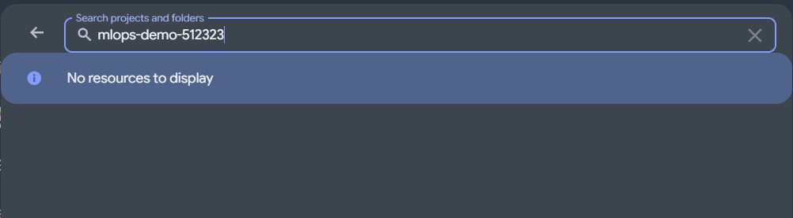

# Lab 7: independent challenge (Marie)

Written and committed **before** running the challenge, so the prediction cannot be
adjusted to the result.

## Claim challenged
From the README section "Recover the accepted version without retraining" (Jade, PR #17):
a member who did not build the bundle can recover the accepted version with the two
README commands only, without retraining, and `bundle verify` refuses bytes that are
not the accepted ones.

## Why this claim
`tests/test_bundle.py` already checks a changed byte on bundles created inside the
tests. It does not show that the real accepted bundle in the bucket can be recovered by
someone else, from a clean checkout, following only the README. That is what Lab 8
will rely on.

## Plan
1. Clean checkout of `main`; follow only the README recovery section.
2. Download `bundles/v1-d24c050e3631` from the bucket and run
   `bundle verify ... --pointer models/accepted.json`.
3. Copy the downloaded bundle, change one byte of `model.joblib` in the copy only,
   and run the same `verify` on the copy.
4. Compare `models/accepted.json` and the bucket listing before and after.

## Prediction
1. The downloaded bundle passes `verify` with exit 0 and the recorded validation MAE.
2. The altered copy fails with a non-zero exit, and the message names `model.joblib`.
3. The pointer and the bucket content are unchanged.

## What would count as a gap
- a README command that does not work as written for someone who did not build it;
- the altered copy passing `verify`;
- any change to the accepted state.

## Access
Read-only access (Storage Object Viewer) on the models bucket requested from Jade.
Status: **refused**. On 8 Nov, the project `mlops-demo-512323` is not visible from my
Google account ("No resources to display"), and Jade cannot grant access. Only Jade can
run the first recovery command.

**Gap found:** the README recovery path depends on one person's cloud access. If she is
not available during the Lab 8 incident, no other member can recover the accepted
bundle. Possible repairs (team decision): ask the instructor to grant read access to the
bucket for every member, or document a second, verified copy of the accepted bundle.

## Results
To be filled after the run, with the raw outputs saved next to this file.