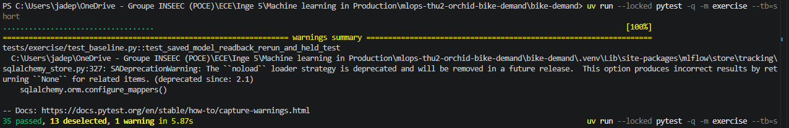
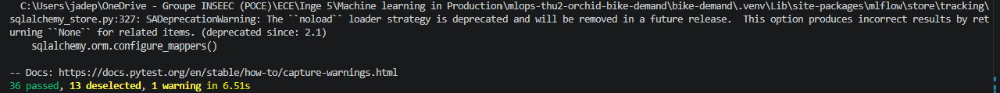
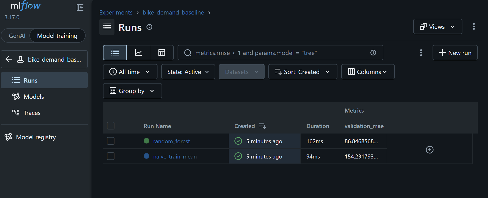

# Week 1, Labs 1–2: shared repository, workflow, validated tracked baseline

## Status
- **Lab 1:** Done by Hajar Benlemqadem and Marie Léona and described below.
- **Lab 2:** Done by Annabelle Fautrad and Jade Parrilla.

## Student / team
- **Students:** Benlemqadem Hajar (`Hajarblmq`), Marie Léona (`Leona224`), Fautrad Annabelle(`annaftrd`), Parrilla Jade (`Jachriso`)
- **Team:** `mlops-thu2-orchid-bike-demand`

---

##  Lab 1: Shared Repository, Workflow & Code Quality Checks

### Roles & Contributions
- **Lab 1 Roles:** Leona224 was the lead author. We (`Hajarblmq` & Marie) acted as peer reviewers and co-validators.
- **Joint Effort:** We set up the project locally on our Macs, checked out Leona's branch, executed the checks, evaluated the test effectiveness against the old code, wrote review feedback, and verified the updated commit before approving and merging.
- **Individual Breakdown:**
  - **Hajar (`Hajarblmq`):** Set up the initial workspace, ran local checks on commit `8eea469`, tested against old `team.py`, identified that the first test did not catch the bug, and drafted the review feedback.
  - **Marie Léona (`Leona224`):** Cross-checked execution logs, verified commit `9677616` against old `team.py` to confirm the new test caught the bug, approved the PR, and assisted with merging and documentation.

### Links to Code and Pull Requests
- **Team repository:** https://github.com/Jachriso/mlops-thu2-orchid-bike-demand
- **Pull request #1 (merged):** #1
- **First commit checked:** `8eea469`
- **Final commit checked and approved:** `9677616` (branch `lab-01-fix-slug`)
- **Review comments / Approval:**  
  

### Test and Execution Results
All commands were run by us on our Macs (arm64), from the `bike-demand/` folder.

#### Commit `8eea469` (first version of the PR)
- `uv run --locked pytest -q -m lab1` -> `4 passed, 44 deselected`
- `uv run --locked ruff check .` -> `All checks passed`
- `uv run --locked ruff format --check .` -> `10 files already formatted`
- `uv run --locked pytest -q` -> `20 passed, 28 failed` (the 28 are the expected Lab 2 `NotImplementedError` TODOs)
- Old `team.py` (`git checkout origin/main -- src/bike_demand/team.py`), then `pytest -q tests/lab1/test_team.py` -> `1 failed, 3 passed`
*Note: The last line is key: the test added in this first version also passed on the old code, meaning it did not protect against the bug.*

#### Commit `9677616` (final version of the PR)
- `git rev-parse --short HEAD` -> `9677616`
- `uv run --locked pytest -q -m lab1` -> `4 passed, 44 deselected`
- `uv run --locked ruff check .` -> `All checks passed`
- Old `team.py`, then `pytest -q tests/lab1/test_team.py` -> `2 failed, 2 passed`
*Note: On the old code, both `test_joins_whitespace_with_hyphens` (supplied) and `test_joins_newlines_with_hyphens` (added) fail, proving the new test properly catches the bug.*

On `9677616`, we did not re-run `ruff format --check`, `pytest -m infra` or the full suite ourselves. Those results come from the PR description written by Leona.

No GitHub CI checks ran on the PR (Checks: 0), so our local runs serve as proof. After each check, we restored `team.py` and ensured `git status --short` was empty.

### Decisions and Rationale
- The fix `"-".join(team_name.lower().split())` follows the specification: it trims, lowercases, joins whitespace with a single hyphen, and raises `ValueError` for blank names.
- We requested a stronger added test. The original test passed on old code because `strip()` already handles tabs/newlines as blank. A proper test had to fail on old code, so we suggested `"Team\nBlue North"` → `"team-blue-north"`.
- We approved the PR only after re-running checks on updated commit `9677616`.

### Review and Response
- **Our finding (on `8eea469`):** The added test passed on old `team.py`. We requested a test that fails on old code.
- **Response:** Leona updated the test to `test_joins_newlines_with_hyphens` (commits `9cddb2c` and `9677616`) and notified us on WhatsApp (no written reply on GitHub).
- **Our follow-up (on `9677616`):** `lab1` 4 passed, `ruff check` OK, and the new test fails on old code as expected.
- **Result:** We approved commit `9677616` and merged the PR into `main`.

### Screenshots
1. **Local checks on commit `9677616`:**  
   

2. **Tests run against old `team.py` (showing test failure as expected):**  
   

3. **Pull Request Approval:**  
   

---

##  Lab 2: Data Validation, Chronological Split & Baseline Tracking

### Roles & Contributions
- **Lab 2 Roles:** Jade PARILLA was the lead author (code, tests, training run). Annabelle FAUTRAD acted as peer reviewer.
- **Jade:** Implemented `check_domains` (`validate.py`), `split_data` (`split.py`), `select_features`, `compare_mean` and `fit_evaluate` (`train.py`), designed Fault B with its fixture and test, and ran the training on Windows 11.
- **Annabelle:** ________

### Links to Code and Pull Requests
- **Branch:** `lab-02-data-baseline`
- **Pull request:** #__
- **Training commit:** `61c2ade4c187006f719e3ed7ce04ba0b7fe8698c` (`working_tree_dirty: false`)
- **Evidence files:** `bike-demand/reports/metrics.json`, `bike-demand/reports/metrics-history.jsonl`

### Test and Execution Results
All commands were run on Windows 11, from the `bike-demand/` folder, on commit `61c2ade`.

- `uv run --locked python -m bike_demand.preflight` -> `Preflight passed`
- `uv run --locked ruff check .` -> `All checks passed`
- `uv run --locked ruff format --check .` -> `11 files already formatted`
- `uv run --locked pytest -q` -> `49 passed` (36 exercise, 9 infra, 4 lab1)
- `uv run --locked python -m bike_demand.validate --data data/raw/hour.csv` -> `Validated 17379 rows; input bytes unchanged.`

**Data identity:** `data/raw/hour.csv`, SHA-256 `e03de4ee4ef4dc376ac6e04bf829673c6269e8eba5c60fa121640fa2f829504f`, 17379 rows, unchanged.

**Partitions** (sorted by `(dteday, hr, instant)`, inclusive intervals):

| Partition | Rows | First key (dteday, hr, instant) | Last key (dteday, hr, instant) |
| --- | --- | --- | --- |
| train | 8645 | (2011-01-01, 0, 1) | (2011-12-31, 23, 8645) |
| validation | 4358 | (2012-01-01, 0, 8646) | (2012-06-30, 23, 13003) |
| test | 4376 | (2012-07-01, 0, 13004) | (2012-12-31, 23, 17379) |

The test partition is counted and held: it is never passed to fitting or evaluation, and no test metric was computed.

**Runs** (config `configs/baseline.yaml` unchanged: n_estimators=50, max_depth=10, random_state=42, n_jobs=1; twelve ordered predictors; both predictors fitted on train only and evaluated on the same 4358 validation rows):

| Run | MLflow run ID | Validation MAE (rentals/hour) |
| --- | --- | --- |
| naive_train_mean (train mean = 143.794) | `25aa2dc702114c43a68154ee20a81931` | 154.232 |
| random_forest | `0656443c0a4c4ce8a907b8d367515b42` | 86.847 |

**Saved model and readback:** `artifacts/model.joblib`, version `baseline-b45ffdb42287`, SHA-256 `fd98ceafc57a5babce61ce703cbf9cb8d1f83c6820b0b34fe30ad1a0fc49c304`. Its run ID is `0656443c0a4c4ce8a907b8d367515b42` (the `random_forest` run), recorded as `model_run_id` in `artifacts/model-metadata.json` and in `reports/metrics.json`. Reloaded model MAE 86.847, delta 0.0, metadata matches, logged model bytes match (`readback` block of `reports/metrics.json`).

**CI and local evidence, checked separately:**
- CI checks on the pull request, for pushed revision `________`: ________
- Local evidence: the MLflow database (`tracking/`) and the saved model (`artifacts/`) are ignored by Git and exist only on Jade's laptop. CI cannot read them, so a green check alone does not verify the runs above; they are verified through `reports/metrics.json`, the MLflow screenshot and the reviewer's inspection.

**Optional stretch (unchanged-config repeat):** not attempted.

### Decisions and Rationale
- The validator raises `ValueError` naming the field and never fills, clips or drops rows.
- The comparator mean uses training labels only; validation labels are used only to measure the error. Averaging validation or test labels would leak the answer into the predictor and make the comparison unfair.
- The test period (July–December 2012) stays held so that it remains unseen data for the single final evaluation at the end of the course. Scoring it now would let later choices adapt to it and make that final estimate optimistic.
- The RF has a lower validation MAE than the train-mean comparator on this fixed split. This is a measured comparison, not a claim about test or future performance.

### Fault B
- **Choice:** `weathersit` set to 5 on one row of a tiny valid copy (`tests/fixtures/weathersit-out-of-domain.csv`), breaking the rule "weathersit is an integer in 1–4"; all columns retained.
- **Reason:** an unknown weather code would otherwise be accepted silently by the Random Forest and produce a prediction for a situation outside the contract.
- **Result:** rejected with `Validation failed: weathersit: require integers in [1, 4]`; the valid control `missing-hours.csv` passes (6 rows) and the canonical CSV still validates. Limitation: the validator checks each field alone, not consistency between fields (for example `cnt = casual + registered`).

### Review and Response
- **Reviewer retrieval (without verbal hints, from this report only):** saved model's run ID found: ________; MAE read: ________; reload evidence inspected: ________
- **Reviewer finding:** ________
- **Author response:** ________
- **Result:** ________

### Screenshots
1. **1st cleared tests**
    
1. **New test cleared**
    
3. **MLflow runs for training commit `61c2ade`:**  
   

---

##  General Notes, Blockers & Acknowledgements

### Blockers / Missing Evidence
- Initial environment issues on Mac (disk space & `uv` compatibility) were resolved by clearing space and using native arm64 `uv` / Python 3.12 versions.
- No remote CI checks ran for this PR.
- Leona's response was shared on WhatsApp rather than GitHub.
- We do not have a screenshot for the first run on `8eea469` (only terminal logs in notes).
- Lab 2 is managed by Annabelle FAUTRAD and Jade PARILLA.

### Assistance and Recovery Acknowledgement
- Starter code and unit tests were provided by the course.
- Lab 2: Jade used an AI assistant (Claude Code) for step-by-step guidance on the implementation, the Fault B test and this report section.
