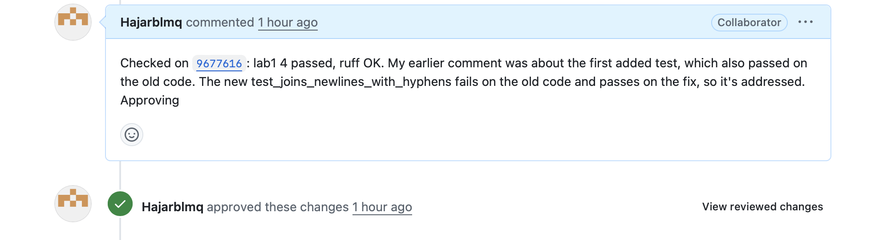
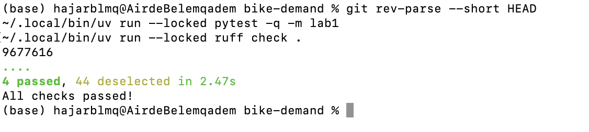
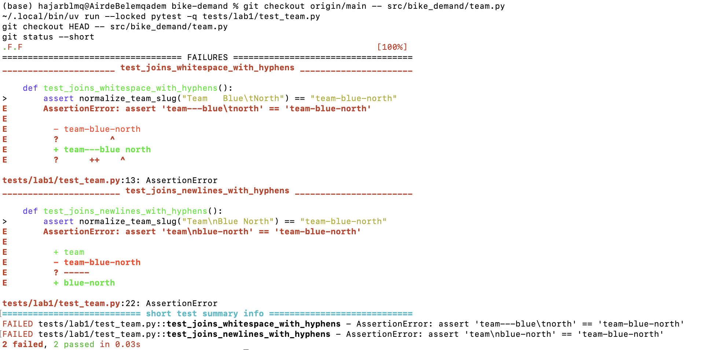

# Week 1, Labs 1–2: shared repository, workflow, validated tracked baseline

## Status
- **Lab 1:** Done by Hajar Benlemqadem and Marie Léona and described below.
- **Lab 2:** Done by Annabelle FAUTRAD and Jade PARILLA.

## Student / team
- **Students:** Benlemqadem Hajar (`Hajarblmq`) and Marie Léona (`Leona224`)
- **Team:** `mlops-thu2-orchid-bike-demand`

---

##  Lab 1: Shared Repository, Workflow & Code Quality Checks

### Roles & Contributions
- **Lab 1 Roles:** Leona224 was the lead author. We (`Hajarblmq` & Marie) acted as peer reviewers and co-validators.
- **Joint Effort:** We set up the project locally on our Macs, checked out Leona's branch, executed the checks, evaluated the test effectiveness against the old code, wrote review feedback, and verified the updated commit before approving and merging.
- **Individual Breakdown:**
  - **Hajar (`Hajarblmq`):** Set up the initial workspace, ran local checks on commit `8eea469`, tested against old `team.py`, identified that the first test did not catch the bug, and drafted the review feedback.
  - **Marie Léona (`Leona224`):** Cross-checked execution logs, verified commit `9677616` against old `team.py` to confirm the new test caught the bug, approved the PR, and assisted with merging and documentation.

### Links to Code and Pull Requests
- **Team repository:** https://github.com/Jachriso/mlops-thu2-orchid-bike-demand
- **Pull request #1 (merged):** #1
- **First commit checked:** `8eea469`
- **Final commit checked and approved:** `9677616` (branch `lab-01-fix-slug`)
- **Review comments / Approval:**  
  

### Test and Execution Results
All commands were run by us on our Macs (arm64), from the `bike-demand/` folder.

#### Commit `8eea469` (first version of the PR)
- `uv run --locked pytest -q -m lab1` -> `4 passed, 44 deselected`
- `uv run --locked ruff check .` -> `All checks passed`
- `uv run --locked ruff format --check .` -> `10 files already formatted`
- `uv run --locked pytest -q` -> `20 passed, 28 failed` (the 28 are the expected Lab 2 `NotImplementedError` TODOs)
- Old `team.py` (`git checkout origin/main -- src/bike_demand/team.py`), then `pytest -q tests/lab1/test_team.py` -> `1 failed, 3 passed`
*Note: The last line is key: the test added in this first version also passed on the old code, meaning it did not protect against the bug.*

#### Commit `9677616` (final version of the PR)
- `git rev-parse --short HEAD` -> `9677616`
- `uv run --locked pytest -q -m lab1` -> `4 passed, 44 deselected`
- `uv run --locked ruff check .` -> `All checks passed`
- Old `team.py`, then `pytest -q tests/lab1/test_team.py` -> `2 failed, 2 passed`
*Note: On the old code, both `test_joins_whitespace_with_hyphens` (supplied) and `test_joins_newlines_with_hyphens` (added) fail, proving the new test properly catches the bug.*

On `9677616`, we did not re-run `ruff format --check`, `pytest -m infra` or the full suite ourselves. Those results come from the PR description written by Leona.

No GitHub CI checks ran on the PR (Checks: 0), so our local runs serve as proof. After each check, we restored `team.py` and ensured `git status --short` was empty.

### Decisions and Rationale
- The fix `"-".join(team_name.lower().split())` follows the specification: it trims, lowercases, joins whitespace with a single hyphen, and raises `ValueError` for blank names.
- We requested a stronger added test. The original test passed on old code because `strip()` already handles tabs/newlines as blank. A proper test had to fail on old code, so we suggested `"Team\nBlue North"` → `"team-blue-north"`.
- We approved the PR only after re-running checks on updated commit `9677616`.

### Review and Response
- **Our finding (on `8eea469`):** The added test passed on old `team.py`. We requested a test that fails on old code.
- **Response:** Leona updated the test to `test_joins_newlines_with_hyphens` (commits `9cddb2c` and `9677616`) and notified us on WhatsApp (no written reply on GitHub).
- **Our follow-up (on `9677616`):** `lab1` 4 passed, `ruff check` OK, and the new test fails on old code as expected.
- **Result:** We approved commit `9677616` and merged the PR into `main`.

### Screenshots
1. **Local checks on commit `9677616`:**  
   

2. **Tests run against old `team.py` (showing test failure as expected):**  
   

3. **Pull Request Approval:**  
   

---

##  General Notes, Blockers & Acknowledgements

### Blockers / Missing Evidence
- Initial environment issues on Mac (disk space & `uv` compatibility) were resolved by clearing space and using native arm64 `uv` / Python 3.12 versions.
- No remote CI checks ran for this PR.
- Leona's response was shared on WhatsApp rather than GitHub.
- We do not have a screenshot for the first run on `8eea469` (only terminal logs in notes).
- Lab 2 is managed by Annabelle FAUTRAD and Jade PARILLA.

### Assistance and Recovery Acknowledgement
- Starter code and unit tests were provided by the course.
