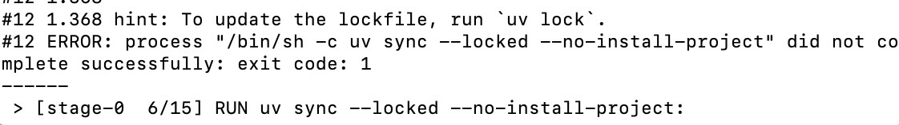
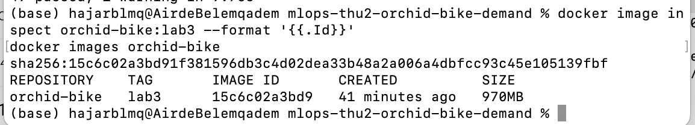
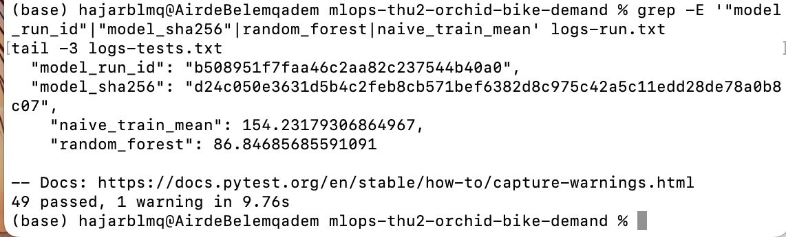
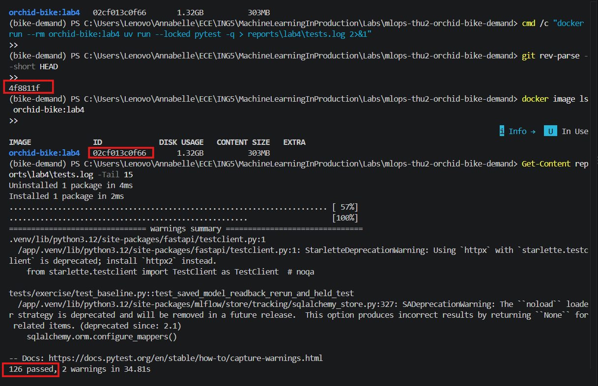
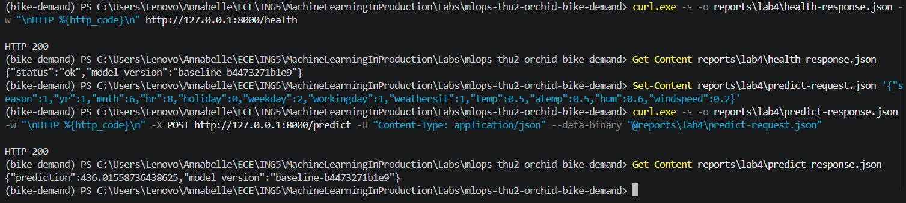
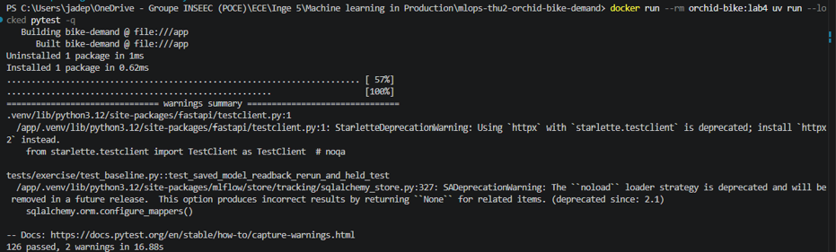
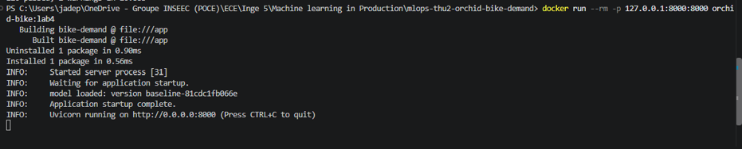
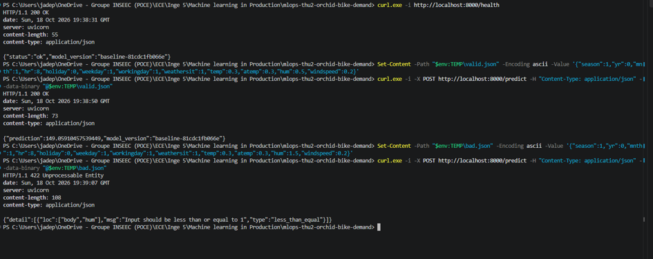
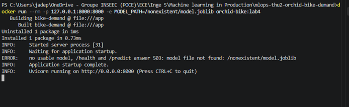
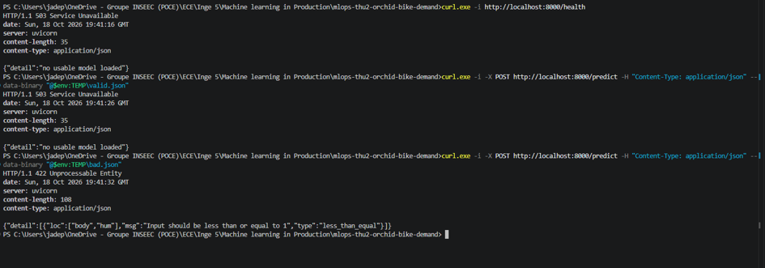

# Week 2, Lab 3: same code, clean environment (locked dependencies, container, rerun)

## Status
- **Lab 3:** Lead author Hajar Benlemqadem (`Hajarblmq`); reviewer Marie Léona (`Leona224`). 
- **Lab 4:** Lead author Fautrad Annabelle (`annaftrd`); reviewer Parrilla Jade (`Jachriso`).

## Student / team
- **Team:** `mlops-thu2-orchid-bike-demand`
- **Students:** Benlemqadem Hajar (`Hajarblmq`), Marie Léona (`Leona224`), Fautrad Annabelle (`annaftrd`), Parrilla Jade (`Jachriso`)

---

## Roles & Contributions
- **Hajar (lead author):** wrote `Dockerfile` and `.dockerignore`, built the image, ran the baseline and the tests in the container, compared with Lab 2, proved that a stale lock fails, wrote the README section.
- **Marie (reviewer):** TODO (she writes her own section below).
- TODO: Annabelle / Jade, if they own an area.

## Links to Code and Pull Requests
- **Branch:** `lab3-docker` (from `main` at `37d5781`, the merge of PR #2)
- **Pull request:** https://github.com/Jachriso/mlops-thu2-orchid-bike-demand/pull/3
- **Commit packaged:** `cd25a99` (on top of `37d5781`, Lab 2 merged)
- **Review / approval:** TODO: link to Marie's review

## Locked
- Lockfile: `bike-demand/uv.lock`, committed and unchanged by this PR.
- Local check on the host: `uv run --locked pytest -q` -> `49 passed`.
- **A stale lock stops the build.** On a throwaway copy (`/tmp/stale-repo`), I added `requests>=2` to `pyproject.toml` without updating `uv.lock`, then ran `docker build`. It fails at `RUN uv sync --locked --no-install-project` with `error: The lockfile at uv.lock needs to be updated, but --locked was provided.` The lock was not regenerated and my branch was not touched. Raw log: `reports/lab3/logs-stale-lock-build.txt`. The same check on the host (`uv sync --locked`) fails with the same message.
  

## Packaged
- Files at the repository root: `Dockerfile`, `.dockerignore`, `README.md` (new section "Lab 3").
- Image: `orchid-bike:lab3`, ID `sha256:15c6c02a3bd91f381596db3c4d02dea33b48a2a006a4dbfcc93c45e105139fbf` (970 MB).
  
- Raw logs: `reports/lab3/logs-build.txt`, `logs-run.txt`, `logs-tests.txt`.

### Dockerfile decisions
- **Base `python:3.12-slim`:** matches `requires-python = ">=3.12,<3.13"`.
- **uv 0.12.24 copied from the official image:** respects `required-version = ">=0.12.19,<0.13"`.
- **`pyproject.toml` and `uv.lock` first, then `uv sync --locked --no-install-project`:** the dependency layer stays cached when only code changes. A second `uv sync --locked` installs the project itself (build backend `uv_build`, needs `src/`).
- **Copied into the image:** `src/`, `configs/`, `data/` (the Lab 2 snapshot), `tests/`, plus `README.md`, `.python-version`, `.github/` and `reports/week-01-team.md`, because the preflight test checks that they exist.
- **Not copied:** `.venv`, `.git`, caches, `.env`, `artifacts/`, `tracking/` and the Lab 2 `reports/metrics.json`, so the rerun starts from zero and cannot reuse earlier outputs.
- **`git` installed with `apt-get`:** `tracking.py` runs `git rev-parse HEAD` and `git status`.
- **`CMD`:** `uv run --locked python -m bike_demand.train --config configs/baseline.yaml` (exec form), the command from the Lab 2 README.

### Failures observed while building (not hidden)
| Step | Result | Cause | Fix |
| --- | --- | --- | --- |
| First test run in the container | 45 passed, 4 failed | preflight reported missing `README.md`, `.python-version`, `reports/week-01-team.md`, `.github/workflows/ci.yml`; the package test and the readback test also failed | copied those files into the image |
| Second run | 48 passed, 1 failed | `FileNotFoundError: 'git'` in the readback test | installed `git` in the image |
| Third run | **49 passed** | | |

No test was deselected or edited.

## Rerun
Inputs unchanged from Lab 2: same data snapshot, same `configs/baseline.yaml`, same split. No tuning, API, cloud or test-set scoring.

| Item | Lab 2 (Jade, Windows 11) | Container (this lab) |
| --- | --- | --- |
| Validation MAE, random forest | 86.84685685591091 | 86.84685685591091 |
| Validation MAE, train-mean comparator | 154.23179306864967 | 154.23179306864967 |
| Train mean | 143.794 | 143.79444765760556 |
| Readback delta | 0.0 | 0.0 |
| `model_run_id` | `0656443c0a4c4ce8a907b8d367515b42` | `b508951f7faa46c2aa82c237544b40a0` |
| `model_sha256` | `fd98ceaf…c304` | `d24c050e…8c07` |

- 49 tests pass in the container; the baseline `CMD` completes and the readback matches.
  
- **Run IDs differ:** expected, each run creates new MLflow runs.
- **MAE identical to every printed digit.**
- **`model_sha256` differs from Lab 2.** Two containers started from the same image gave the same hash (`d24c050e…`), so the container rerun is stable. Python is the same on the host and in the container (3.12.15) and the packages come from the same `uv.lock`. The Lab 2 model was produced on Windows 11, so a platform effect is plausible, but **we did not establish the cause**. A rerun on a Mac outside Docker was started and not completed, so it is not evidence.
- The `model_version` string also changed between our container runs (`baseline-e09ff6eeb7fc`, `baseline-264a4ea24207`) while the model hash did not. We did not look at how it is computed.
- **Commit tracking differs from Lab 2.** In the container, `metrics.json` records `training_commit: "unavailable"` and `working_tree_dirty: null`, because `.git` is excluded from the image and `tracking.py` falls back to these values when git has no repository. Lab 2 recorded commit `61c2ade…` with `working_tree_dirty: false`. The commit is therefore tracked outside the container (`git rev-parse HEAD`, here `cd25a99`).

## Revision, image, run
| Link | Value |
| --- | --- |
| Revision | `cd25a99` + `uv.lock` |
| Image | `sha256:15c6c02a3bd9…` (build log in `reports/lab3/logs-build.txt`) |
| Run | `model_run_id` `b508951f7faa46c2aa82c237544b40a0`, MAE 86.847 |

## Decisions and Rationale
- The lock drives the install; a stale lock must stop the build, never be repaired to get green.
- `.git` stays out of the build context so the image does not depend on the laptop.
- The image carries only the files the tests and baseline need; outputs of earlier runs stay out.

## Review and Response

### Reviewer's reproduction (Marie)
TODO: Marie writes this section: clean clone of `lab3-docker`, README only, her build, run and test results, her image ID and `model_sha256`, her finding(s), and the approval commit.

## Local vs remote checks
All runs above are local (Docker Desktop on a Mac). No GitHub CI check was used as evidence for this lab.

## Blockers / Missing Evidence
- The cause of the different `model_sha256` is not established (see Rerun).
- TODO: add anything Marie could not reproduce.

## Screenshots
1. Build and image ID: 
2. Run and tests: 
3. Stale lock stops `docker build`: 

## Review follow-up (Marie's findings on PR #3)
- **Stale lock in `docker build`:** shown on a throwaway copy, see "Locked" and `reports/lab3/logs-stale-lock-build.txt`. The README wording was fixed accordingly.
- **Commit behind the image:** image `15c6c02a…` was built from the working directory (base commit `37d5781` plus the `Dockerfile` and `.dockerignore`, committed afterwards in `cd25a99`). `git diff 37d5781 cd25a99 -- bike-demand` is empty, so the project code is identical.
- **`model_sha256`:** Marie reproduced `d24c050e…` inside Docker on Windows 11. Jade's Lab 2 run on Windows outside Docker gave `fd98ceaf…`. This suggests the difference comes from the host environment, but we did not isolate the exact cause.
- **Owners (Annabelle, Jade):** TODO
- **Why `uv run` reinstalls the project at start-up:** TODO

## Assistance and recovery acknowledgement

## Lab 4: Prediction API

### Roles & Contributions
- **Annabelle (lead author):** input validation, model loading + `/health` + `/predict`, tests, container, README, report.
- **Jade (reviewer):** checked out PR #6, ran the tests in the container, tried a valid request, an out-of-range request and a missing model, reported findings and approved/merged the PR.

### Links to Code and Pull Requests
- **Branch:** `lab4-api` (from `main` at `13c9408`, the merge of PR #3)
- **Pull request:** https://github.com/Jachriso/mlops-thu2-orchid-bike-demand/pull/6 (merged into `main` as `8e054f4`)
- **Code tested in the image:** `4f8811f`; later commits add only logs, README and report text.
- **Review / approval:** see "Review and Response" below

### Contract
| Case | Status |
| --- | --- |
| Valid request, model loaded | 200, finite `prediction` >= 0 and `model_version` |
| Invalid request (missing/extra field, wrong type, out of range, NaN/Infinity, malformed JSON) | 422, even without a model |
| Valid request, model missing or unusable | 503 (`/health` also 503) |
| Model error or invalid model output | 500 |

### Decisions and Rationale
- **Extra fields are rejected (422)**, so `cnt`, `casual` and `registered` cannot be sent as inputs.
- **Strict types:** `"2"`, `2.0` for an integer field and `true` are rejected.
- **The 422 body contains only `loc`, `msg`, `type`**, never the submitted value (a NaN in the input could otherwise break the error response).
- **The service never trains.** It loads `model.joblib` at startup and takes `model_version` from `model-metadata.json`. If the file is missing, corrupt, or its feature list differs from the contract, it stays up and answers 503.
- **Multi-stage Dockerfile:** training runs at build time in a `trainer` stage; the final image only receives `artifacts/`.

### Evidence from the image
| Item | Value |
| --- | --- |
| Image | `orchid-bike:lab4`, ID `02cf013c0f66` (built at `4f8811f`) |
| Tests in the image | `uv run --locked pytest -q`: 126 passed |
| `GET /health` | 200, `model_version` `baseline-b4473271b1e9` |
| `POST /predict` (valid) | 200, `prediction` 436.0155873643862, same `model_version` |
| `hum = 1.5` | 422 |
| `MODEL_PATH=/nonexistent/model.joblib` | 503 on `/health` and `/predict` |
| Raw logs | `reports/lab4/` (`build.log`, `tests.log`, `*-response.json`, `service.log`, `nomodel-service.log`) |

### Limits and Missing Evidence
- All runs are in Docker; the author's Windows machine blocks the scikit-learn DLLs, so nothing was run natively.
- No remote CI check was used as evidence.
- The `model_version` string changes between builds (as observed in Lab 3, and again in the review: `baseline-b4473271b1e9` vs `baseline-81cdc1fb066e`); we did not investigate why.
- The reviewer's runs were captured as screenshots only; no raw log files were added for them.

### Review and Response

#### Reviewer's reproduction
Local checkout of PR #6 (`pr-6` at `918d245`; `git diff 4f8811f 918d245` touches only `README.md`, `reports/` and `images/`, so the code is the one Annabelle tested). Image rebuilt as `orchid-bike:lab4` with Docker Desktop on Windows 11, following the README only.

| Check | Command | Result |
| --- | --- | --- |
| Tests in the image | `docker run --rm orchid-bike:lab4 uv run --locked pytest -q` | **126 passed**, 2 warnings |
| Service start | `docker run --rm -p 127.0.0.1:8000:8000 orchid-bike:lab4` | `model loaded: version baseline-81cdc1fb066e` |
| `GET /health` | `curl.exe -i http://localhost:8000/health` | 200, `{"status":"ok","model_version":"baseline-81cdc1fb066e"}` |
| `POST /predict`, valid request (`mnth=1`, `hr=8`, `temp=0.3`, `hum=0.5`) | `curl.exe -i -X POST .../predict --data-binary "@valid.json"` | 200, `prediction` 149.05910457539449, same `model_version` |
| **Bad request:** `hum = 1.5` | same, with `bad.json` | 422, `{"loc":["body","hum"],"msg":"Input should be less than or equal to 1","type":"less_than_equal"}` (submitted value not echoed) |
| **Missing model:** `-e MODEL_PATH=/nonexistent/model.joblib` | service start | stays up, logs `ERROR: no usable model, /health and /predict answer 503: model file not found: /nonexistent/model.joblib` |
| `GET /health`, no model | | 503, `{"detail":"no usable model loaded"}` |
| `POST /predict` valid, no model | | 503, `{"detail":"no usable model loaded"}` |
| `POST /predict` bad, no model | | **422** (validation runs before the model check, as the contract says) |

Every row matches the contract table above.

#### Findings
- **`model_version` differs from the author's build** (`baseline-81cdc1fb066e` for me, `baseline-b4473271b1e9` for Annabelle) on the same code and lock. This confirms the limit already listed: the version string is not reproducible across builds, so it identifies a build, not a revision. Not blocking for this lab; to investigate in Lab 5–6 (model-version checks).
- **Two warnings in the test run**, both from dependencies, not from our code: `StarletteDeprecationWarning` (`starlette.testclient` with `httpx`) and an SQLAlchemy `noload` deprecation raised inside MLflow. They do not fail any test; noted so a future upgrade does not surprise us.
- **`uv run` reinstalls the project at each container start** (`Uninstalled 1 package / Installed 1 package` before Uvicorn starts, also before pytest). Harmless (under 1 ms) but it means the container modifies its own environment at start-up; this is the same behaviour as the open Lab 3 question.
- No blocking defect found.

#### Approval
- Approved and merged: PR https://github.com/Jachriso/mlops-thu2-orchid-bike-demand/pull/6, head `2ccb1ed`, merge commit `8e054f4` on `main`.

