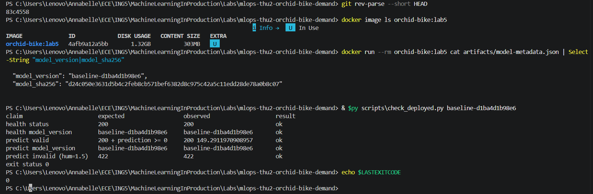
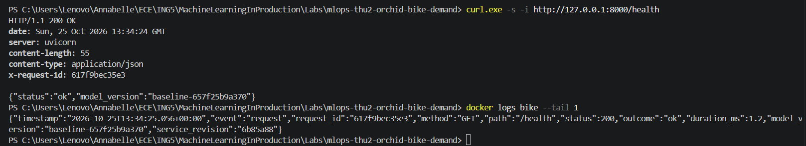
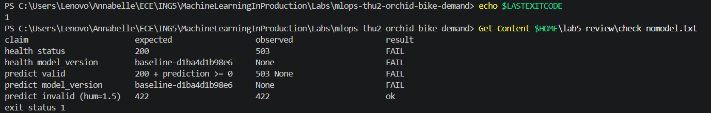

# Week 3, Labs 5–6: deployment, structured logs, model-version checks, GitHub Actions

## Status
- **Lab 5:** done and merged on `main` (`db8886a`) through three pull requests:
  - start-up: Marie Léona (`Leona224`), PR #8, reviewed by Parrilla Jade (`Jachriso`);
  - external check: Benlemqadem Hajar (`Hajarblmq`), PR #9, merged by Fautrad Annabelle (`annaftrd`);
  - logging: Annabelle, PR #10, merged by Hajar.
- **Lab 5 final check:** run by Jade on `main` at `d41f51c` (all claims ok), output `reports/lab5/lab5-final-check.txt` (commit `806c39c`).
- **Lab 6:** done and merged on `main` (`4287323`) through four pull requests (#12 CI, #13 tests, #14 CI completion, #15 deploy). `main` was deployed to Cloud Run by the deploy workflow: revision `mlops-thu2-orchid-bike-demand-demo-00008-z4d`, live check 5 ok.

## Student / team
- **Team:** `mlops-thu2-orchid-bike-demand`
- **Students:** Benlemqadem Hajar (`Hajarblmq`), Marie Léona (`Leona224`), Fautrad Annabelle (`annaftrd`), Parrilla Jade (`Jachriso`)

---

# Lab 5: Service deployment, structured logging and model-version checks

## Roles & Contributions
- **Léona (start-up):** wrote the "Lab 5: Deploy" README section: how to start the Lab 4 image with settings passed by `-e`, the settings table (`MODEL_PATH`, `METADATA_PATH`), the answers to *settings*, *model*, *ready* and *broken*, and a failure caused on purpose (missing model). No code change.
- **Hajar (check):** wrote `scripts/check_deployed.py`, a check that runs outside the container, and the README answers to *identity*, *expected* and *promise*. Added raw outputs in `evidence/` (moved to `reports/lab5/` in this PR).
- **Annabelle (logging):** added one JSON log line per request in `api.py`, the `X-Request-ID` response header, the code revision in the image (`SERVICE_REVISION`), 19 tests in `tests/test_request_logging.py`, and the README answers to *log line* and *secrets*.
- **Jade (review, README, report, final check):** reviewed PR #8 by following only the README in Windows PowerShell, changed one setting at start-up, merged PR #8; rewrote the three Lab 5 README sections into one path a stranger can follow; wrote this report; runs the final check.
- **Merges:** Annabelle merged PR #9; Hajar merged PR #10.

## Links to Code and Pull Requests

| PR | Branch | Author | Head reviewed / merged | Merge commit on `main` | Merged by |
| --- | --- | --- | --- | --- | --- |
| [#8](https://github.com/Jachriso/mlops-thu2-orchid-bike-demand/pull/8) start-up | `lab-05-startup` | Léona | `dfe8c35` | `e3fbc55` | Jade |
| [#9](https://github.com/Jachriso/mlops-thu2-orchid-bike-demand/pull/9) check | `lab-05-check` | Hajar | `83c4558` | `8a436fc` | Annabelle |
| [#10](https://github.com/Jachriso/mlops-thu2-orchid-bike-demand/pull/10) logging | `lab-05-logging` | Annabelle | `ce96691` | `db8886a` | Hajar |

### README consolidation (this PR)
The three Lab 5 README sections were written separately and did not form one path: two different build commands (only one passed `--build-arg SERVICE_REVISION`), `curl` instead of `curl.exe` in the start-up block, `python3` (opens the Microsoft Store on Windows), another image and container name in the Check section, no example `/predict` body, no `docker rm -f bike` before "Break it", a sentence made false by PR #10 ("the per-request lines show 503 without the reason"), and a leftover line ("and the model beats the baseline."). They were merged into one section "Lab 5: Deploy, log and check the service": nine numbered steps (build, expected model, start, ready, requests, logs, check, break it, stop), then settings, the ten answers grouped by author, evidence and limits. No answer was removed; the only content changes are the fixes above, the cause of the changing `model_version` (`uuid4()` in `train.py`), and the name of who runs the final check.

PR #7 (first version of the start-up PR) was closed without merge and replaced by PR #8 after the branch was renamed from `lab5-startup` to `lab-05-startup`.

## What was added

| Path | Change | PR |
| --- | --- | --- |
| `README.md` | sections "Lab 5: Deploy", "Lab 5: Check", "Lab 5: Logging": the 10 README questions, each with choice, rejected option and reason | #8, #9, #10 |
| `scripts/check_deployed.py` | external check, standard library only, HTTP to `127.0.0.1:8000` | #9 |
| `bike-demand/src/bike_demand/api.py` | request-logging middleware, `X-Request-ID` header, `reason` / `error_fields` for failures | #10 |
| `Dockerfile` | `ARG/ENV SERVICE_REVISION` (default `unknown`), `--no-access-log` | #10 |
| `bike-demand/tests/test_request_logging.py` | 19 tests on the log line | #10 |
| `reports/lab5/` | raw outputs of the check, the logs and the tests (added in `evidence/` by #9 and #10, moved to `reports/lab5/` like `reports/lab3/` and `reports/lab4/`) | #9, #10, this PR |

No dependency was added: `pyproject.toml` and `uv.lock` are unchanged. The API contract from Lab 4 is unchanged; only the `X-Request-ID` header was added.

## Decisions and Rationale
The full answers (choice, rejected option, why) are in the README. In short:

| Question | Our choice | Rejected |
| --- | --- | --- |
| settings | only the model location changes, via `-e MODEL_PATH` / `METADATA_PATH`; same image everywhere | hard-coded paths, per-machine config baked in the image |
| model | trained once at build time (`trainer` stage), loaded once at start-up | training or downloading at start-up |
| ready | `GET /health` answers 200 with a `model_version` | "container running", `Application startup complete` (both appear without a model) |
| broken | stays up and fails closed: 503 on `/health` and `/predict`, 422 still returned for bad input, one `ERROR` line at start-up | crashing at start-up, answering a default prediction |
| log line | one JSON line per request: `timestamp`, `request_id`, `method`, `path`, `status`, `outcome`, `duration_ms`, `model_version`, `service_revision`, plus `reason` (503/500) or `error_fields` (422) | uvicorn access line (no model, no reason, duplicate), free text |
| secrets | never log bodies, query strings, headers, env variables, predictions, client-chosen paths (logged as `(other)`), test-period metrics | logging the whole request "to debug" |
| identity | `model_version` from `/health` and `/predict` | image tag (movable), image ID (one build, not the model) |
| expected | read from the image right after the build (`docker run --rm orchid-bike:lab5 cat artifacts/model-metadata.json`), passed to the script as an argument | reading it from the running service, hard-coding it in the repo |
| promise | started from the README; `/health` 200; valid `/predict` 200 with a finite prediction >= 0; bad input 422; `model_version` equals the recorded value; the check exits 0 | "the container is running" |
| failure | missing model: 503 + one `ERROR` line naming the file; since PR #10 each 503 line also says `"reason":"no_model"` | — |

## Commit → Image → Run

Each run below was made by its author on their own machine. Image IDs differ because each person built their own image.

| Run | Commit | Image | Command | Raw evidence |
| --- | --- | --- | --- | --- |
| Start-up (Léona, Windows 11) | `cab9507` | `sha256:76a4c8754c32…` | `docker run -d --name bike -p 127.0.0.1:8000:8000 -e MODEL_PATH=… orchid-bike:lab5` | table in PR #8 description only (no raw log file in the repo) |
| Review of #8 (Jade, Windows 11) | `dfe8c35` | `sha256:5fc956bbcd64…` | same, then `MODEL_PATH=/nonexistent/model.joblib`, then `METADATA_PATH=/nope.json` | review text in the merge commit `e3fbc55`; raw logs kept in Jade's personal repository (`reports/lab5/`) |
| Check (Hajar, Mac) | `cab9507` | `sha256:53a5ab37451b…` (`bike-demand:dev`) | `python3 scripts/check_deployed.py <expected>` | `reports/lab5/lab5-check-ok.txt`, `reports/lab5/lab5-check-fail.txt`, `reports/lab5/lab5-logs-raw.txt` |
| Logging (Annabelle) | `6b85a88` | `8c5567d14241` (`orchid-bike:lab5`, `--build-arg SERVICE_REVISION=6b85a88`) | start as in "Deploy", requests, `docker logs bike`, check script, `pytest -q` in the image | `reports/lab5/lab5-logging-ok-logs.txt`, `-broken-logs.txt`, `-check.txt`, `-tests.txt` |

### Observed results

**Start-up and failure (PR #8, author and reviewer):**

| Request | Model loaded | `MODEL_PATH=/nonexistent/…` | `METADATA_PATH=/nope.json` (reviewer) |
| --- | --- | --- | --- |
| `GET /health` | 200 + `model_version` | 503 `no usable model loaded` | 503 |
| `POST /predict` valid | 200 + prediction + `model_version` | 503 | — |
| `POST /predict` `hum = 1.5` | 422 | 422 | — |
| start-up log | `model loaded: version …` | `ERROR: … model file not found: /nonexistent/model.joblib` | `ERROR: … metadata file not found: /nope.json` |

**External check (PR #9, `reports/lab5/lab5-check-*.txt`):**

```
claim                       expected                  observed                    result
health status               200                       200                         ok
health model_version        baseline-32b2127e4f74     baseline-32b2127e4f74       ok
predict valid               200 + prediction >= 0     200 149.2911970908957       ok
predict model_version       baseline-32b2127e4f74     baseline-32b2127e4f74       ok
predict invalid (hum=1.5)   422                       422                         ok
exit status 0
```

With `expected = mauvaise-valeur`, the two `model_version` claims are `FAIL` and the script exits 1. The check was run again on the logging image (`reports/lab5/lab5-logging-check.txt`): 5 ok, exit 0.

**Logging (PR #10, `reports/lab5/lab5-logging-*.txt`):** one line per request, for example:

```
{"timestamp":"2026-10-25T13:26:40.416+00:00","event":"request","request_id":"ca7faa38cbb1","method":"POST","path":"/predict","status":200,"outcome":"ok","duration_ms":78.3,"model_version":"baseline-657f25b9a370","service_revision":"6b85a88"}
{"timestamp":"2026-10-25T13:26:54.999+00:00","event":"request","request_id":"1c6bb5cafae3","method":"POST","path":"/predict","status":422,"outcome":"rejected","duration_ms":0.7,"model_version":"baseline-657f25b9a370","service_revision":"6b85a88","error_fields":["body.hum"]}
{"timestamp":"2026-10-25T13:41:30.003+00:00","event":"request","request_id":"dbf8b5e13088","method":"POST","path":"/predict","status":503,"outcome":"unavailable","duration_ms":2.0,"model_version":null,"service_revision":"6b85a88","reason":"no_model"}
```

- Running container: 4 requests (200, 200, 422, 404) gave 4 lines; the `x-request-id` header equals the logged `request_id`. The 404 path is logged as `(other)`.
- Tests in the image: `145 passed, 2 warnings` (126 existing + 19 new). The warnings come from dependencies (Starlette, MLflow/SQLAlchemy), as in Lab 4.
- The 422 line names the field (`body.hum`), never the value sent.

## Screenshots







## Findings

- **Why `model_version` changes between builds (open question since Lab 3).** We observed five different strings: `baseline-42b3b51f3431` (Léona), `baseline-4afd7a832628` (Jade), `baseline-32b2127e4f74` (Hajar), `baseline-d1ba4d1b98e6` and `baseline-657f25b9a370` (Annabelle). The cause is in the code: `train.py` builds the label with `uuid4()`, a random value drawn at each training, and training runs at each `docker build` (unless the `trainer` stage comes from the Docker cache). Hajar and Annabelle both read the same `model_sha256` (`d24c050e…`) in their images, the same value as in Lab 2–3. So the model file is the same; only its label is random. This is why `expected` must be read from the image after the build and cannot be stored in the repository.
- **Same model, different image IDs.** Jade's two builds of `dfe8c35` gave two image IDs with the same `model_version`, because the `trainer` stage was reused from the cache. Neither the image ID nor the commit says which model runs; only the metadata does.
- **Code identity is visible but not checked.** Since PR #10 every log line carries `service_revision`, but only if the image is built with `--build-arg SERVICE_REVISION=…` (otherwise `"unknown"`). The check script compares `model_version` only, and `/health` does not return `model_sha256` or the revision.

## Exit check: could a stranger tell which model and code are answering?

- **Model:** yes, partly. `/health`, `/predict` and every log line give `model_version`, and the check fails if it differs from the value read in the image. The label is random, so it identifies one build, not the model file; the file hash (`model_sha256`) is not exposed by the service.
- **Code:** only from the logs (`service_revision`), and only if the builder passed the build argument. The check does not verify it. This is the main gap to close in Lab 6.

## Review and Response

### PR #8 (start-up), reviewed by Jade
Followed only the README in Windows PowerShell, on `lab-05-startup` at `dfe8c35`. Image `sha256:5fc956bbcd648f20b8546d0f8ff248ea38e99696400e9691d049dfe2edd63d84`, `model_version` `baseline-4afd7a832628`.
- Start-up as documented: `/health` 200, valid `/predict` 200, `hum = 1.5` 422, port published on `127.0.0.1:8000` only.
- The README "Break it" command gave 503 / 503 / 422 and the documented `ERROR` line.
- **Changed one thing:** `-e METADATA_PATH=/nope.json` gave 503 and `metadata file not found: /nope.json`, which confirms the settings table ("same as above").
- Findings (non-blocking):
  1. The code block says `curl -i …`; in Windows PowerShell 5.1 `curl` is an alias of `Invoke-WebRequest` and the copy-paste opens a prompt asking for `Uri`. The `curl.exe` hint is below the block.
  2. If port 8000 is still used by a previous container, the new one stays in `Created` and `curl` reaches the old, healthy one. Suggested `docker rm -f bike` before "Break it".
- Approved and merged (`e3fbc55`). The review text is in the merge commit message; on GitHub it was not submitted as a formal "Approve" review.

### PR #9 (check) and PR #10 (logging)
- PR #9 was merged by Annabelle with the message "Merging after review (commit 83c4558). The check passes, fails on a wrong version and fails cleanly with no model."
- PR #10 was merged by Hajar.
- **No review or comment is recorded on GitHub for either PR** (0 reviews, 0 comments). See "Missing evidence".

## Limits and Missing Evidence
- **Reviews of PR #9 and #10 are not visible** on GitHub; the reviewers' commands and observations are not recorded. PR #8 has the review only in the merge commit message.
- **Final check committed without a pull request.** Jade ran it on `main` at `d41f51c` (25 October 2026): 5 claims ok, exit 0; broken model 503 / 503 / 422, exit 1. The output `reports/lab5/lab5-final-check.txt` was committed directly on `main` (`806c39c`), not through a reviewed pull request.
- **Start-up evidence of PR #8 has no raw log file** in the team repository; the author's results are only in the PR description.
- A traceback from an unexpected model error still goes to the container log through `uvicorn.error`; its content was not reviewed.
- `uv run` re-installs the project at each container start (`Uninstalled 1 package / Installed 1 package`), as already noted in Lab 4. Cause found in Week 3: uv compares the ctime of `pyproject.toml` and `src/` with the one it recorded at build time, and Docker resets the ctime when it writes the image layers (raw output in `reports/lab3/uv-reinstall-diagnosis.txt`, explanation in `reports/week-2.md`).
- All Lab 5 runs are local, on our own machines. No remote CI was used as evidence; CI and the Cloud Run deploy are in Lab 6 below.

## Assistance and recovery acknowledgement
- Jade used an AI assistant (Claude) to prepare the review of PR #8 (list of checks, PowerShell commands, wording of the review comment), to restructure the Lab 5 README and to draft this report from the commits, PR descriptions and `reports/lab5/` files. Every result in the review was run and seen by Jade; values in this report are copied from the repository, the PR descriptions and the raw logs.
- Other members: no AI assistance is declared in the descriptions or commits of PR #8 (Léona), #9 (Hajar) and #10 (Annabelle), and no instructor recovery function was used. If an author used an AI assistant, they add it to this line before `m3`.

---

# Lab 6: GitHub Actions, CI checks, regression tests and deploy

## Roles & Contributions
- **Annabelle (workflow):** wrote the first CI workflow at the repository root (`.github/workflows/ci.yml`, PR #12): locked install, preflight, `ruff check`, `ruff format --check`, then the whole test suite in a second job that waits for lint. Saved the first red run as text and repaired it on the same PR.
- **Hajar (tests):** wrote the regression tests (`bike-demand/tests/test_lab06_catch.py`, PR #13) and registered the `regression` marker in `pyproject.toml`. Made each test red on purpose and saved the output (`reports/lab6/lab6-tests-regression-red.txt`).
- **Jade (review, CI completion, deploy, README, report):** reviewed PR #13 and merged it; completed the CI (PR #14: separate regression step, concurrency, test-log artifact); wrote the deploy workflow (PR #15); set up the Google Cloud side (Cloud Run service, Artifact Registry repository `orchid-bike`, Workload Identity Federation, deploy account `github-deployer`, repository variables); diagnosed and repaired the red deploy; wrote the README "Lab 6" section and this report.
- **Léona:** merged PR #14 and PR #15.
- **Merges:** Hajar merged #12; Jade merged #13; Léona merged #14 and #15.

## Links to Code and Pull Requests

| PR | Branch | Author | Head merged | Merge commit on `main` | Merged by |
| --- | --- | --- | --- | --- | --- |
| [#12](https://github.com/Jachriso/mlops-thu2-orchid-bike-demand/pull/12) CI workflow | `lab-06-workflow-ci` | Annabelle | `04e6d97` | `08b1ad9` | Hajar |
| [#13](https://github.com/Jachriso/mlops-thu2-orchid-bike-demand/pull/13) regression tests | `lab-06-tests` | Hajar | `67ac71d` | `7f061b4` | Jade |
| [#14](https://github.com/Jachriso/mlops-thu2-orchid-bike-demand/pull/14) CI completion | `lab-06-ci-regression` | Jade | `00aca40` | included in `4287323` (merged with #15, which was based on it) | Léona |
| [#15](https://github.com/Jachriso/mlops-thu2-orchid-bike-demand/pull/15) deploy | `lab-06-deploy` | Jade | `9e8ad05` | `4287323` | Léona |

## What was added

| Path | Change | PR |
| --- | --- | --- |
| `.github/workflows/ci.yml` | CI at the repository root: `lint` job (locked install, preflight, ruff), `tests` job after it; later split into fast tests and regression tests, concurrency, test logs uploaded even when red | #12, #14 |
| `.github/workflows/deploy.yml` | deploy after a green CI on a push to `main`: keyless login, image tagged with the commit, new revision with no traffic, traffic switch, live check, rollback if the check fails, deploy record | #15 |
| `bike-demand/tests/test_lab06_catch.py` | 2 regression tests: retrain with the project code and compare both validation MAEs with `reports/metrics.json` (tolerance `1e-6`) | #13 |
| `bike-demand/pyproject.toml` | `regression` marker registered (`--strict-markers` is on) | #13 |
| `bike-demand/src/bike_demand/api.py`, `tests/test_api.py`, `tests/test_request_logging.py` | `ruff format` only (repair of CI run #1) | #12 |
| `scripts/check_deployed.py` | reads `BASE_URL`, `ID_TOKEN` and `CHECK_TIMEOUT` from the environment, so the Lab 5 check also runs against the private Cloud Run URL | #15 |
| `reports/lab6/` | raw logs as text: CI run #1 (red), regression tests made red, deploy attempt 1 (red) and attempt 2 (green), live check | #12, #13, this PR |
| `README.md` | section "Lab 6: CI and deploy to Cloud Run": what runs, how to reproduce a failure, test map, the 14 answers, red to green, deploy record, limits | this PR |

No dependency was added: `uv.lock` is unchanged, and every install in CI and in the image uses `--locked`.

## Decisions and Rationale
The full answers (choice, rejected option, why) are in the README. In short:

| Question | Our choice | Rejected |
| --- | --- | --- |
| coverage | gaps listed: no Docker build or running API in CI, Linux only, README commands and check script not tested, quality = "same MAE as recorded" | a Docker build on every PR (about 2 min, already done by the deploy) |
| machine | nothing of ours on the runner: install from `uv.lock`, retrain from the data snapshot | committing a model or caching `.venv` |
| trigger | every PR and push to `main` run all of CI, no path filter; deploy only after green CI on `main` | path filters (preflight reads the README, so docs can break CI) |
| order | lint (19 s to fail) → fast tests → regression | one job with one `pytest` run |
| evidence | runner-made facts only: commit, lock, checks, recomputed MAE; nothing about laptop MLflow runs or the deployed model | citing local runs as CI evidence |
| defects | one named defect per test (test map) | `assert True` placeholder |
| failing | each test made red on purpose, output saved as text | trusting a test only seen green |
| tolerance | `1e-6`: fixed seed, delta 0.0 measured locally and on the runner | a loose tolerance (0.5) |
| repair | fix the cause in a commit or a permission; never mute the check | removing the check, `continue-on-error` |
| records | raw logs in `reports/lab6/`, metrics in the repo | links to runs and artifacts (expire after 14 / 30 days) |
| gate | `workflow_run` of CI, only `success` + `push` + `main`, deploys the tested `head_sha` | deploy job inside `ci.yml` (puts `id-token: write` next to PR jobs) |
| identity | Workload Identity Federation, short-lived OIDC token → `github-deployer` | a JSON key stored as a secret |
| proof | Lab 5 check on the live URL, expected `model_version` read from the image of the same run, record with the revision | "deploy printed Done" |
| undo | new revision with `--no-traffic`; previous revision recorded and kept serving until the switch; rollback step if the live check fails | deploying with immediate traffic |

## Red → diagnosis → repair → green

### CI, PR #12 (Annabelle)

| Run | Commit | Result |
| --- | --- | --- |
| CI #1 | `ddfd529` | **red** at `ruff format --check .`: `Would reformat: src/bike_demand/api.py`, `tests/test_api.py`, `tests/test_request_logging.py`, `3 files would be reformatted`, exit code 1 (`reports/lab6/lab6-ci-ddfd529-red.txt`) |
| — | `9ca1521` | red log saved as text |
| — | `d720474` | **repair:** `ruff format` applied to the three files (formatting only, 145 insertions / 146 deletions) |
| CI #2 | `d720474` | **green** |

**Cause:** the Lab 5 files had never been checked by `ruff format`, because there was no CI before. The check was kept as it is; the code was fixed.

### Deploy, run #1 on `main` (Jade)

| Attempt | Commit | Result |
| --- | --- | --- |
| 1 (14:48–14:50 UTC) | `4287323` | **red** at "Deploy a new revision of the Lab 5 service" (`reports/lab6/lab6-deploy-1-red.txt`) |
| 2 (14:59–15:01 UTC) | `4287323` | **green**: revision `00008-z4d` at 100%, live check 5 ok, exit 0 (`reports/lab6/lab6-deploy-2-green.txt`, `reports/lab6/lab6-deploy-live-check.txt`) |

What the attempt 1 log shows: login without a key, build, push to `orchid-bike` and the new revision `00007-m94` (0% of the traffic) all succeeded. The traffic switch then failed:

```
Updating traffic failed
Traffic:
  100% mlops-thu2-orchid-bike-demand-demo-00005-j4x
ERROR: (gcloud.run.services.update-traffic) PERMISSION_DENIED: Permission 'artifactregistry.repositories.downloadArtifacts' denied on resource '//artifactregistry.googleapis.com/projects/mlops-demo-512323/locations/europe-west1/repositories/cloud-run-source-deploy' (or it may not exist). [...] This command is authenticated as github-deployer@mlops-demo-512323.iam.gserviceaccount.com [...]
```

**Diagnosis.** Traffic can only be moved if the deploy account can read the image of every revision concerned, not only the new one. The revision serving before, `00005-j4x`, came from the service Jade had created by hand from source in Lab 6 setup, so its image is in the `cloud-run-source-deploy` repository. `github-deployer` could write to our `orchid-bike` repository but could not read `cloud-run-source-deploy`.

**Repair.** Jade granted `github-deployer` the Artifact Registry `reader` role on `cloud-run-source-deploy`, then re-ran the failed job. Nothing changed in the repository, so attempt 2 ran on the same commit: it is a re-run after the cause was fixed in Google Cloud, not a re-run "until green". No step was muted and the traffic switch was kept.

**Undo seen for real.** While the traffic switch failed, the previous revision `00005-j4x` kept 100% of the traffic: users kept the old, working service. This is the answer to *undo* in the README. The rollback step itself (live check red) was not triggered.

## Deploy record

From `reports/lab6/lab6-deploy-live-check.txt` (deploy run #1, attempt 2):

| Item | Value |
| --- | --- |
| Commit | `4287323da4162adfc1d8039b29e050ae9dbfc4ee` (merge of PR #15 on `main`) |
| CI that gated it | CI #27, push to `main`, green: lint, 145 fast tests, 2 regression tests |
| Image | `europe-west1-docker.pkg.dev/mlops-demo-512323/orchid-bike/orchid-bike:4287323da4162adfc1d8039b29e050ae9dbfc4ee` |
| Expected model (read from that image) | `baseline-cf856982003d` |
| Checked revision | `mlops-thu2-orchid-bike-demand-demo-00008-z4d`, 100% of the traffic |
| Previous revision | `mlops-thu2-orchid-bike-demand-demo-00005-j4x` |
| Live check | `/health` 200, `model_version` ok, valid `/predict` 200 (149.29), `predict model_version` ok, `hum = 1.5` 422; exit status 0 |
| URL | `https://mlops-thu2-orchid-bike-demand-demo-7md3wlybfq-ew.a.run.app` (private: identity token required) |

## Tests: what they catch

| Test | Defect | Shown red |
| --- | --- | --- |
| `ruff format --check` | unformatted code | CI #1 (`ddfd529`) |
| `test_random_forest_validation_mae_matches_recorded` | training code drift (target, features, split, settings) | target `registered`: 113.93 vs 86.85 |
| `test_naive_mean_validation_mae_matches_recorded` | comparator drift (statistic, split) | `median` instead of `mean`: 159.95 vs 154.23 |
| live check in the deploy | wrong model, no answer, invalid input accepted | Lab 5 only (`lab5-check-fail.txt`) |

The regression outputs were produced on Hajar's Mac (the path in the log is `/Users/hajarblmq/...`), not on the runner. On the runner (CI #27), both regression tests passed: `2 passed, 145 deselected`.

## Review and Response

### PR #13 (tests), reviewed by Jade
- **`d27f48f` (first version):** the only new test was `assert True`. Jade posted a comment asking for changes (21:56 UTC): it can never fail, so it catches no defect (Lab 6 "Catch" and rule 2).
- **`795e513`:** the test recomputed the MAE and caught a shifted validation window (85.52 vs 86.85), but trained its own copy of the model: a wrong target in `train.py` (`registered`) **still passed**. It also added an unused data link.
- **Response (`409183c`, `67ac71d`):** the test now calls the project code (`fit_evaluate`, `compare_mean`, `split_data`), the unused file was removed, the `regression` marker was registered, and the red outputs were saved. The wrong target now fails (113.93 vs 86.85). CI #22 was red on `409183c` (`ruff format`, missing final newline), repaired by `67ac71d`, CI #23 green. Jade merged (`7f061b4`).
- The comment is a plain comment, not a formal GitHub "Request changes" or "Approve" review.

### PR #12, #14 and #15
- **No review or comment is recorded on GitHub** for these three PRs (0 reviews, 0 comments). #12 was merged by Hajar, #14 and #15 by Léona.

## Exit check: could our pipeline have failed? Show me.

Yes, and it did, for real reasons:
- CI run #1 failed on unformatted code, and was repaired by formatting it.
- The regression tests fail when the training target or the comparator is changed (outputs saved).
- The deploy failed on a missing permission, while the old revision kept serving, and turned green after the permission was fixed.

## Limits and Missing Evidence
- **"Break it on purpose" not done.** No teammate has opened a pull request with a hidden defect for the test author yet; there is no PR and no run for it.
- **Reviews:** no formal GitHub review on any Lab 6 PR; only one comment (Jade on #13). `main` is not protected by a branch rule.
- **The regression red outputs come from a laptop**, not from the runner. The runner only shows them green.
- **The rollback step was never triggered**, and the live check was never seen red on Cloud Run.
- **Same tag, two images.** Attempt 2 rebuilt the image (the model is retrained during the build, so `model_version` changed from `baseline-e980b74b3569` to `baseline-cf856982003d`) and pushed it under the same tag `orchid-bike:<sha>`. The revision `00007-m94` from attempt 1 still exists with 0% of the traffic.
- The model deployed is not the one CI tested: CI checks that the training code reproduces the recorded MAE; the deploy checks the model identity in its own image.
- The permission fix was made in the Google Cloud console / Cloud Shell; there is no text log of that command in the repository.
- The `m3` tag has not been created yet.

## Assistance and recovery acknowledgement
- Jade used an AI assistant (Claude Code) to draft the CI completion and deploy workflows, the README "Lab 6" section and this report, from the workflows, the PR history and the raw logs in `reports/lab6/`. The Google Cloud setup, the deploy runs, the diagnosis and the permission fix were done by Jade; values in this report are copied from the logs and the repository.
- Other members: no AI assistance is declared in the descriptions or commits of PR #12 (Annabelle) and #13 (Hajar); Léona only merged #14 and #15. No instructor recovery function was used. If an author used an AI assistant, they add it to this line before `m3`.
