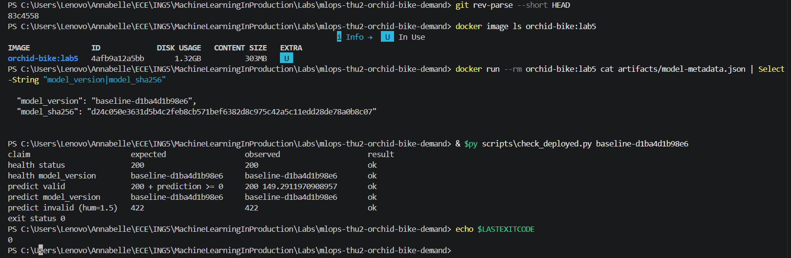
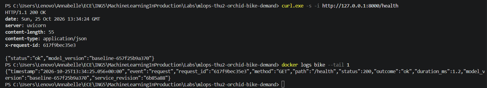
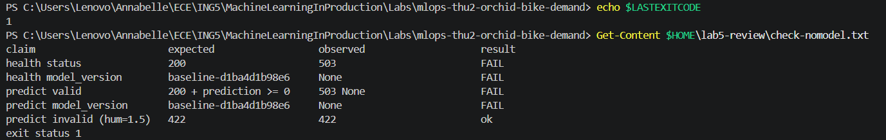

# Week 3, Labs 5–6: deployment, structured logs, model-version checks, GitHub Actions

## Status
- **Lab 5:** done and merged on `main` (`db8886a`) through three pull requests:
  - start-up: Marie Léona (`Leona224`), PR #8, reviewed by Parrilla Jade (`Jachriso`);
  - external check: Benlemqadem Hajar (`Hajarblmq`), PR #9, merged by Fautrad Annabelle (`annaftrd`);
  - logging: Annabelle, PR #10, merged by Hajar.
- **Lab 6:** not started yet (section to come).

## Student / team
- **Team:** `mlops-thu2-orchid-bike-demand`
- **Students:** Benlemqadem Hajar (`Hajarblmq`), Marie Léona (`Leona224`), Fautrad Annabelle (`annaftrd`), Parrilla Jade (`Jachriso`)

---

# Lab 5: Service deployment, structured logging and model-version checks

## Roles & Contributions
- **Léona (start-up):** wrote the "Lab 5: Deploy" README section: how to start the Lab 4 image with settings passed by `-e`, the settings table (`MODEL_PATH`, `METADATA_PATH`), the answers to *settings*, *model*, *ready* and *broken*, and a failure caused on purpose (missing model). No code change.
- **Hajar (check):** wrote `scripts/check_deployed.py`, a check that runs outside the container, and the README answers to *identity*, *expected* and *promise*. Added raw outputs in `evidence/` (moved to `reports/lab5/` in this PR).
- **Annabelle (logging):** added one JSON log line per request in `api.py`, the `X-Request-ID` response header, the code revision in the image (`SERVICE_REVISION`), 19 tests in `tests/test_request_logging.py`, and the README answers to *log line* and *secrets*.
- **Jade (review, README, report, final check):** reviewed PR #8 by following only the README in Windows PowerShell, changed one setting at start-up, merged PR #8; rewrote the three Lab 5 README sections into one path a stranger can follow; wrote this report; runs the final check.
- **Merges:** Annabelle merged PR #9; Hajar merged PR #10.

## Links to Code and Pull Requests

| PR | Branch | Author | Head reviewed / merged | Merge commit on `main` | Merged by |
| --- | --- | --- | --- | --- | --- |
| [#8](https://github.com/Jachriso/mlops-thu2-orchid-bike-demand/pull/8) start-up | `lab-05-startup` | Léona | `dfe8c35` | `e3fbc55` | Jade |
| [#9](https://github.com/Jachriso/mlops-thu2-orchid-bike-demand/pull/9) check | `lab-05-check` | Hajar | `83c4558` | `8a436fc` | Annabelle |
| [#10](https://github.com/Jachriso/mlops-thu2-orchid-bike-demand/pull/10) logging | `lab-05-logging` | Annabelle | `ce96691` | `db8886a` | Hajar |

### README consolidation (this PR)
The three Lab 5 README sections were written separately and did not form one path: two different build commands (only one passed `--build-arg SERVICE_REVISION`), `curl` instead of `curl.exe` in the start-up block, `python3` (opens the Microsoft Store on Windows), another image and container name in the Check section, no example `/predict` body, no `docker rm -f bike` before "Break it", a sentence made false by PR #10 ("the per-request lines show 503 without the reason"), and a leftover line ("and the model beats the baseline."). They were merged into one section "Lab 5: Deploy, log and check the service": nine numbered steps (build, expected model, start, ready, requests, logs, check, break it, stop), then settings, the ten answers grouped by author, evidence and limits. No answer was removed; the only content changes are the fixes above, the cause of the changing `model_version` (`uuid4()` in `train.py`), and the name of who runs the final check.

PR #7 (first version of the start-up PR) was closed without merge and replaced by PR #8 after the branch was renamed from `lab5-startup` to `lab-05-startup`.

## What was added

| Path | Change | PR |
| --- | --- | --- |
| `README.md` | sections "Lab 5: Deploy", "Lab 5: Check", "Lab 5: Logging": the 10 README questions, each with choice, rejected option and reason | #8, #9, #10 |
| `scripts/check_deployed.py` | external check, standard library only, HTTP to `127.0.0.1:8000` | #9 |
| `bike-demand/src/bike_demand/api.py` | request-logging middleware, `X-Request-ID` header, `reason` / `error_fields` for failures | #10 |
| `Dockerfile` | `ARG/ENV SERVICE_REVISION` (default `unknown`), `--no-access-log` | #10 |
| `bike-demand/tests/test_request_logging.py` | 19 tests on the log line | #10 |
| `reports/lab5/` | raw outputs of the check, the logs and the tests (added in `evidence/` by #9 and #10, moved to `reports/lab5/` like `reports/lab3/` and `reports/lab4/`) | #9, #10, this PR |

No dependency was added: `pyproject.toml` and `uv.lock` are unchanged. The API contract from Lab 4 is unchanged; only the `X-Request-ID` header was added.

## Decisions and Rationale
The full answers (choice, rejected option, why) are in the README. In short:

| Question | Our choice | Rejected |
| --- | --- | --- |
| settings | only the model location changes, via `-e MODEL_PATH` / `METADATA_PATH`; same image everywhere | hard-coded paths, per-machine config baked in the image |
| model | trained once at build time (`trainer` stage), loaded once at start-up | training or downloading at start-up |
| ready | `GET /health` answers 200 with a `model_version` | "container running", `Application startup complete` (both appear without a model) |
| broken | stays up and fails closed: 503 on `/health` and `/predict`, 422 still returned for bad input, one `ERROR` line at start-up | crashing at start-up, answering a default prediction |
| log line | one JSON line per request: `timestamp`, `request_id`, `method`, `path`, `status`, `outcome`, `duration_ms`, `model_version`, `service_revision`, plus `reason` (503/500) or `error_fields` (422) | uvicorn access line (no model, no reason, duplicate), free text |
| secrets | never log bodies, query strings, headers, env variables, predictions, client-chosen paths (logged as `(other)`), test-period metrics | logging the whole request "to debug" |
| identity | `model_version` from `/health` and `/predict` | image tag (movable), image ID (one build, not the model) |
| expected | read from the image right after the build (`docker run --rm orchid-bike:lab5 cat artifacts/model-metadata.json`), passed to the script as an argument | reading it from the running service, hard-coding it in the repo |
| promise | started from the README; `/health` 200; valid `/predict` 200 with a finite prediction >= 0; bad input 422; `model_version` equals the recorded value; the check exits 0 | "the container is running" |
| failure | missing model: 503 + one `ERROR` line naming the file; since PR #10 each 503 line also says `"reason":"no_model"` | — |

## Commit → Image → Run

Each run below was made by its author on their own machine. Image IDs differ because each person built their own image.

| Run | Commit | Image | Command | Raw evidence |
| --- | --- | --- | --- | --- |
| Start-up (Léona, Windows 11) | `cab9507` | `sha256:76a4c8754c32…` | `docker run -d --name bike -p 127.0.0.1:8000:8000 -e MODEL_PATH=… orchid-bike:lab5` | table in PR #8 description only (no raw log file in the repo) |
| Review of #8 (Jade, Windows 11) | `dfe8c35` | `sha256:5fc956bbcd64…` | same, then `MODEL_PATH=/nonexistent/model.joblib`, then `METADATA_PATH=/nope.json` | review text in the merge commit `e3fbc55`; raw logs kept in Jade's personal repository (`reports/lab5/`) |
| Check (Hajar, Mac) | `cab9507` | `sha256:53a5ab37451b…` (`bike-demand:dev`) | `python3 scripts/check_deployed.py <expected>` | `reports/lab5/lab5-check-ok.txt`, `reports/lab5/lab5-check-fail.txt`, `reports/lab5/lab5-logs-raw.txt` |
| Logging (Annabelle) | `6b85a88` | `8c5567d14241` (`orchid-bike:lab5`, `--build-arg SERVICE_REVISION=6b85a88`) | start as in "Deploy", requests, `docker logs bike`, check script, `pytest -q` in the image | `reports/lab5/lab5-logging-ok-logs.txt`, `-broken-logs.txt`, `-check.txt`, `-tests.txt` |

### Observed results

**Start-up and failure (PR #8, author and reviewer):**

| Request | Model loaded | `MODEL_PATH=/nonexistent/…` | `METADATA_PATH=/nope.json` (reviewer) |
| --- | --- | --- | --- |
| `GET /health` | 200 + `model_version` | 503 `no usable model loaded` | 503 |
| `POST /predict` valid | 200 + prediction + `model_version` | 503 | — |
| `POST /predict` `hum = 1.5` | 422 | 422 | — |
| start-up log | `model loaded: version …` | `ERROR: … model file not found: /nonexistent/model.joblib` | `ERROR: … metadata file not found: /nope.json` |

**External check (PR #9, `reports/lab5/lab5-check-*.txt`):**

```
claim                       expected                  observed                    result
health status               200                       200                         ok
health model_version        baseline-32b2127e4f74     baseline-32b2127e4f74       ok
predict valid               200 + prediction >= 0     200 149.2911970908957       ok
predict model_version       baseline-32b2127e4f74     baseline-32b2127e4f74       ok
predict invalid (hum=1.5)   422                       422                         ok
exit status 0
```

With `expected = mauvaise-valeur`, the two `model_version` claims are `FAIL` and the script exits 1. The check was run again on the logging image (`reports/lab5/lab5-logging-check.txt`): 5 ok, exit 0.

**Logging (PR #10, `reports/lab5/lab5-logging-*.txt`):** one line per request, for example:

```
{"timestamp":"2026-10-25T13:26:40.416+00:00","event":"request","request_id":"ca7faa38cbb1","method":"POST","path":"/predict","status":200,"outcome":"ok","duration_ms":78.3,"model_version":"baseline-657f25b9a370","service_revision":"6b85a88"}
{"timestamp":"2026-10-25T13:26:54.999+00:00","event":"request","request_id":"1c6bb5cafae3","method":"POST","path":"/predict","status":422,"outcome":"rejected","duration_ms":0.7,"model_version":"baseline-657f25b9a370","service_revision":"6b85a88","error_fields":["body.hum"]}
{"timestamp":"2026-10-25T13:41:30.003+00:00","event":"request","request_id":"dbf8b5e13088","method":"POST","path":"/predict","status":503,"outcome":"unavailable","duration_ms":2.0,"model_version":null,"service_revision":"6b85a88","reason":"no_model"}
```

- Running container: 4 requests (200, 200, 422, 404) gave 4 lines; the `x-request-id` header equals the logged `request_id`. The 404 path is logged as `(other)`.
- Tests in the image: `145 passed, 2 warnings` (126 existing + 19 new). The warnings come from dependencies (Starlette, MLflow/SQLAlchemy), as in Lab 4.
- The 422 line names the field (`body.hum`), never the value sent.

## Screenshots







## Findings

- **Why `model_version` changes between builds (open question since Lab 3).** We observed five different strings: `baseline-42b3b51f3431` (Léona), `baseline-4afd7a832628` (Jade), `baseline-32b2127e4f74` (Hajar), `baseline-d1ba4d1b98e6` and `baseline-657f25b9a370` (Annabelle). The cause is in the code: `train.py` builds the label with `uuid4()`, a random value drawn at each training, and training runs at each `docker build` (unless the `trainer` stage comes from the Docker cache). Hajar and Annabelle both read the same `model_sha256` (`d24c050e…`) in their images, the same value as in Lab 2–3. So the model file is the same; only its label is random. This is why `expected` must be read from the image after the build and cannot be stored in the repository.
- **Same model, different image IDs.** Jade's two builds of `dfe8c35` gave two image IDs with the same `model_version`, because the `trainer` stage was reused from the cache. Neither the image ID nor the commit says which model runs; only the metadata does.
- **Code identity is visible but not checked.** Since PR #10 every log line carries `service_revision`, but only if the image is built with `--build-arg SERVICE_REVISION=…` (otherwise `"unknown"`). The check script compares `model_version` only, and `/health` does not return `model_sha256` or the revision.

## Exit check: could a stranger tell which model and code are answering?

- **Model:** yes, partly. `/health`, `/predict` and every log line give `model_version`, and the check fails if it differs from the value read in the image. The label is random, so it identifies one build, not the model file; the file hash (`model_sha256`) is not exposed by the service.
- **Code:** only from the logs (`service_revision`), and only if the builder passed the build argument. The check does not verify it. This is the main gap to close in Lab 6.

## Review and Response

### PR #8 (start-up), reviewed by Jade
Followed only the README in Windows PowerShell, on `lab-05-startup` at `dfe8c35`. Image `sha256:5fc956bbcd648f20b8546d0f8ff248ea38e99696400e9691d049dfe2edd63d84`, `model_version` `baseline-4afd7a832628`.
- Start-up as documented: `/health` 200, valid `/predict` 200, `hum = 1.5` 422, port published on `127.0.0.1:8000` only.
- The README "Break it" command gave 503 / 503 / 422 and the documented `ERROR` line.
- **Changed one thing:** `-e METADATA_PATH=/nope.json` gave 503 and `metadata file not found: /nope.json`, which confirms the settings table ("same as above").
- Findings (non-blocking):
  1. The code block says `curl -i …`; in Windows PowerShell 5.1 `curl` is an alias of `Invoke-WebRequest` and the copy-paste opens a prompt asking for `Uri`. The `curl.exe` hint is below the block.
  2. If port 8000 is still used by a previous container, the new one stays in `Created` and `curl` reaches the old, healthy one. Suggested `docker rm -f bike` before "Break it".
- Approved and merged (`e3fbc55`). The review text is in the merge commit message; on GitHub it was not submitted as a formal "Approve" review.

### PR #9 (check) and PR #10 (logging)
- PR #9 was merged by Annabelle with the message "Merging after review (commit 83c4558). The check passes, fails on a wrong version and fails cleanly with no model."
- PR #10 was merged by Hajar.
- **No review or comment is recorded on GitHub for either PR** (0 reviews, 0 comments). See "Missing evidence".

## Limits and Missing Evidence
- **Reviews of PR #9 and #10 are not visible** on GitHub; the reviewers' commands and observations are not recorded. PR #8 has the review only in the merge commit message.
- **Final check not yet run.** The README now names who runs it (Jade, on `main` after the last Lab 5 merge, before `m3`); its output `reports/lab5/lab5-final-check.txt` does not exist yet.
- **Start-up evidence of PR #8 has no raw log file** in the team repository; the author's results are only in the PR description.
- A traceback from an unexpected model error still goes to the container log through `uvicorn.error`; its content was not reviewed.
- `uv run` re-installs the project at each container start (`Uninstalled 1 package / Installed 1 package`), as already noted in Lab 4.
- All runs are local, on our own machines. No remote CI was used as evidence; this is Lab 6.

## Assistance and recovery acknowledgement
- Jade used an AI assistant (Claude) to prepare the review of PR #8 (list of checks, PowerShell commands, wording of the review comment), to restructure the Lab 5 README and to draft this report from the commits, PR descriptions and `reports/lab5/` files. Every result in the review was run and seen by Jade; values in this report are copied from the repository, the PR descriptions and the raw logs.
- Other members: to be completed by each author.

---

# Lab 6: GitHub Actions

*To be completed.*
