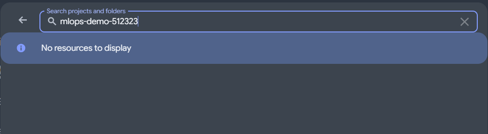

# Week 4, Labs 7–8: training pipeline, quality gate, incident diagnosis, verified rollback

## Student / team
- **Team:** `mlops-thu2-orchid-bike-demand`
- **Students:** Hajar Benlemqadem (`Hajarblmq`), Marie Léona Nomo Ngah (`Leona224`), Annabelle Fautrad (`annaftrd`), Jade Parrilla (`Jachriso`)

| Lab | Area | Owner |
| --- | --- | --- |
| 7 | Accepted bundle v1, pointer, bucket, recovery path | Jade (PR #17) |
| 7 | Policy and gate decision function | Annabelle (PRs #18, #19, #22) |
| 7 | Candidate pipeline and real candidate runs | Hajar (PRs #21, #23, #24) |
| 7 | Independent challenge of the recovery claim | Marie (PR #20) |
| 8 | Operator, recorder, incident record, `RUNBOOK.md` | Marie (PR #25) |
| 8 | Fault injector | Hajar (branch `lab-08-injector`) |
| 8 | Review and merge of the incident record | Annabelle (PR #25) |
| — | Held-out test score and v1.0.0 release | Marie (PR #26, tag `v1.0.0`) |

## Links to code and pull requests
- Lab 7: PRs #17, #18, #19, #20, #21, #22, #23, #24 (all merged into `main`).
- Lab 8: PR #25, incident record and `RUNBOOK.md`, merged as `6c68cf7`.
- Final test score and README Lab 8 section: PR #26 .
- Release: tag `v1.0.0` on `main` at `6c68cf7`.

## Test and execution results (commands, revision, observed output)

### Lab 7: candidates against v1
Gate policy: `bike-demand/policy/gate-policy.yaml`; records: `bike-demand/reports/lab7/decisions/`. Accept requires beating the naive baseline **and** a validation MAE ≤ 85.11 (2 % better than v1, 86.85).

| Candidate (trees / depth) | Validation MAE | Outcome |
| --- | --- | --- |
| 50 / 3 | 105.10 | reject |
| 200 / 15 | 86.19 | reject |
| 500 / 20 | 85.99 | reject |
| 5000 / 3 | — | blocked (budget) |

### Lab 7: recovery challenge (Marie, PR #20)
| Prediction | Observed |
| --- | --- |
| Real bundle passes `bundle verify` | `status: ok`, exit 0, MAE 86.84685685591091 |
| Copy with one changed bit is refused | `integrity: model.joblib sha256 differs from the manifest`, exit 1, refused before loading |
| Accepted state unchanged | pointer identical to `main`; original still `d24c050e…` |

Raw: `reports/lab7/lab7-marie-verify-genuine.txt`, `lab7-marie-verify-tampered.txt`.

### Lab 8: incident drill (local Docker, image `97e4f5be…`, commit `ccabd24`)
| Period (UTC) | 30 requests (5 health, 20 valid, 5 invalid) | `model_version` | Same valid request |
| --- | --- | --- | --- |
| Baseline, 2026-11-08 23:27 | 200 / 200 / 422 as expected | `baseline-0b7ee4462ec6` | — |
| Incident, 23:54 | 200 / 200 / 422 as expected | **`candidate-0e02f6bbae83-1`** | **119.18** |
| After rollback, 2026-11-09 00:08 | 200 / 200 / 422 as expected | `baseline-0b7ee4462ec6` | 149.53 |

Latency stayed around 10 ms in all three periods. Raw evidence: `reports/lab8/`.

### Final held-out test score (run once, 22 Nov, PR #26)
| Model | Validation MAE | Test MAE (Jul–Dec 2012, 4,376 rows) |
| --- | --- | --- |
| Random forest v1 | 86.85 | **93.74** |
| Naive train mean | 154.23 | 182.21 |

Command: `uv run --locked python ../scripts/held_test.py bundles/v1-d24c050e3631` (verifies the bundle against the pointer first, no retraining). Raw: `reports/held-test-v1.txt`.

## Screenshots

## Decisions and rationale
- **Accepted state = exact bytes.** The pointer names the bundle by its manifest digest; `model_version` alone is random and changes at every training.
- **Recover, never retrain.** Retraining gives a new `model_version`, and on another platform a different `model_sha256` (Lab 2 vs Lab 3).
- **Gate rules before candidates.** The policy was committed before any candidate was evaluated.
- **Hypotheses before checks (Lab 8).** Two hypotheses (another model / same model, new label) were committed before any check; the model sha256 and `bundle verify` kept the first.
- **One controlled change.** Rollback = verify v1, then swap only the mounted bundle; recovery proved with fresh requests, not by a successful command.
- **Local drill.** The operator had no GCP access; the lab allows a local drill.
- **Test period scored once,** at the end, on the already accepted v1; nothing was chosen after it.

## Review and response
- PR #20 (Marie's challenge): reviewed and merged by Jade.
- PR #25 (incident record, `RUNBOOK.md`): merged by Annabelle.
- Finding from Lab 7, carried into Lab 8: recovery depended on one member's bucket access; documented in `RUNBOOK.md` (section 4.1).
- PR #26

## Blockers / missing evidence
- Only Jade can access the GCP project and the models bucket; the incident drill was therefore local, not on Cloud Run.
- Cloud Run still serves a model retrained at deploy time, not the v1 bundle (promotion to serving not done).
- The service does not check the loaded model against `models/accepted.json`; `/health` has no `model_sha256`.

## Assistance and recovery acknowledgement
Course slides and starter code. Claude (AI assistant) was used by Marie to plan the drill, write PowerShell commands, and draft the incident record, the held-test script; each member reviewed their own parts.